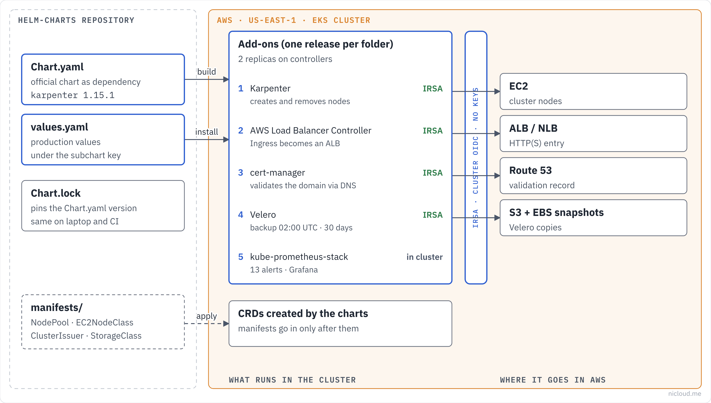

<!-- curso: Nicloud · Kubernetes on AWS -->
# Module 1 – Helm and the wrapper chart pattern

## Learning objectives

In this module, you will learn to:

- Describe what a **chart**, a **release** and a chart **repository** are.
- Recognize each file in a chart: `Chart.yaml`, `values.yaml`, `Chart.lock`, `charts/` and `ci/`.
- Explain the **wrapper chart** pattern and why it makes addon upgrades cheap.
- Tell `helm dependency build` from `helm dependency update` and pin versions safely.
- Override values of a **subchart** and predict which value wins when there are several files.
- Run the lifecycle of a release: install, upgrade, check history, roll back and remove.
- Explain why **CRDs**, and the manifests that depend on them, require an install order.
- Test every chart with `helm lint` and `helm template` in a CI pipeline.

## Architecture

Overview of what this repository does, in the Nicloud diagram style: callers on the left, rules in the middle, destinations on the right. This module covers the foundation every addon uses. Modules 2, 3 and 4 go into each addon.



## Helm, chart and release

<u>**Helm**</u> is the package manager for Kubernetes. It takes a package of templates, fills it with your values and hands the finished manifests to the cluster API.

The package is called a <u>**chart**</u>. Each installation of a chart in a cluster becomes a <u>**release**</u>, with its own name (`karpenter`, `cert-manager`) and a **revision history**. Every `helm upgrade` creates a new revision, and Helm stores what was applied in each one. That is what lets you go back in time with `helm rollback`.

Charts are published in a <u>**repository**</u>. There are two kinds: the classic **HTTP** repository (an `index.yaml` on a server, such as `https://charts.jetstack.io`) and the **OCI** registry, the same standard used for container images (such as `oci://public.ecr.aws/karpenter`).

### When to use it

Use Helm for third-party software you will install in more than one cluster and upgrade many times: Karpenter, cert-manager, Prometheus, Velero. The maintainer has already solved RBAC, CRDs, probes and upgrades inside the chart.

For two or three manifests of your own that rarely change, `kubectl apply` or Kustomize are simpler. Helm charges the price of a template layer.

## Anatomy of a chart

A chart is a folder with fixed file names:

| File or folder | What it is for |
|---|---|
| `Chart.yaml` | Name, chart version, software version (`appVersion`) and dependencies |
| `values.yaml` | Default values the installer can change |
| `templates/` | Manifests with `{{ }}` markers that Helm fills in |
| `charts/` | Dependency charts, downloaded as `.tgz` |
| `Chart.lock` | The exact version of each dependency, written by Helm |
| `crds/` | CRDs installed before everything else, only on the first install |
| `ci/*-values.yaml` | Extra values used only in tests |

`Chart.yaml` has two versions that confuse people: `version` is the version **of the chart** (the packaging) and `appVersion` is the version **of the software** it installs. In this repository the wrapper stays at `0.1.0` and `appVersion` follows the addon.

## Example: anatomy in this repo

The `karpenter/` folder has everything an addon needs and nothing more:

```text
karpenter/
├── Chart.yaml          # declares the official chart as a dependency
├── Chart.lock          # exact version downloaded
├── charts/
│   └── karpenter-1.15.1.tgz
├── values.yaml         # production values only
├── manifests/          # applied after the chart
│   ├── default-nodepool.yaml
│   └── ec2nodeclass.yaml
└── README.md
```

Notice there is no `templates/`. The templates come from the official chart, inside the `.tgz`.

## Wrapper chart

This repository does not copy the official charts. Each folder is a <u>**wrapper chart**</u>: a small chart that declares the official chart as a **dependency** and keeps only the production values.

Copying the official chart into the repository (the well-known "chart fork") looks like control, but it costs a lot later. Every new version becomes a manual merge of hundreds of templates. With a wrapper, upgrading an addon means changing a number in `Chart.yaml` and reviewing the values diff.

The wrapper also answers the question "what did we change from the default?". The answer is exactly `values.yaml`, short and reviewable.

## Example: the Karpenter wrapper

```yaml
# karpenter/Chart.yaml
apiVersion: v2
name: karpenter
version: 0.1.0
appVersion: "1.15.1"
dependencies:
  - name: karpenter
    version: "1.15.1"
    repository: "oci://public.ecr.aws/karpenter"
```

### How it works

#### (1) Download the dependency

`helm dependency build karpenter` reads `Chart.yaml` and `Chart.lock` and downloads the `.tgz` from the OCI registry into `karpenter/charts/`.

#### (2) Install with the production values

`helm install karpenter . -n karpenter --create-namespace -f values.yaml` installs the wrapper. Since the wrapper has no templates, the resources are generated by the `karpenter` subchart, using the values from here.

## Dependencies and pinned versions

The two dependency commands do different things:

- `helm dependency build` honors **Chart.lock**. It downloads exactly the recorded versions. It is the everyday and CI command.
- `helm dependency update` ignores the lock, resolves the versions in `Chart.yaml` again and **rewrites** the lock. It is the command for when you want to upgrade.

If `Chart.yaml` changes and the lock does not, Helm refuses with "the lock file (Chart.lock) is out of sync". It is a safeguard: it stops anyone from changing a version without recording it.

The version in `Chart.yaml` accepts ranges (`~1.16.0`, `>=1.0.0`, `"*"`). For production addons, pin the exact version. A range makes the same commit install different things on different days.

## Example: Linkerd's "*" version

Until November 2026, both Linkerd charts used `version: "*"` pointing at the `edge` channel, which publishes new versions every week. Each `helm dependency update` could bring a different control plane without anyone asking for it.

```yaml
# linkerd/linkerd-control-plane/Chart.yaml
dependencies:
  - name: linkerd-control-plane
    version: "2026.11.1"
    repository: https://helm.linkerd.io/edge
```

The fix pinned the version, generated `Chart.lock` and stored the `.tgz` in `charts/`. Upgrading Linkerd is now a decision with a commit, not a side effect.

## Subchart values

The official chart's values live **under a key named after the dependency**. The wrapper passes to the subchart only what is under that key.

```yaml
# cert-manager/values.yaml
cert-manager:          # dependency name in Chart.yaml
  crds:
    enabled: true
  replicaCount: 2
```

If you write `replicaCount: 2` at the root, the value stays in the wrapper, cert-manager never sees it and keeps one replica. `helm lint` does not complain, because to it this is just an unused value.

### Which value wins

Helm merges values in this order, and the last one wins:

1. The official chart's `values.yaml` (inside the `.tgz`)
2. The wrapper's `values.yaml`
3. Each `-f file.yaml`, in the order given
4. Each `--set key=value`

The test script relies on exactly this: it passes `-f values.yaml` and then `-f ci/test-values.yaml`, so the test value wins.

## Placeholders: what to replace before installing

The `values.yaml` files come with uppercase markers for everything that depends on your environment:

| Marker | Where it appears | Replace with |
|---|---|---|
| `CLUSTER_NAME` | Karpenter, ALB, ExternalDNS, Fluent Bit | EKS cluster name |
| `CLUSTER_ENDPOINT` | Karpenter | Cluster API endpoint |
| `ACCOUNT_ID` and `*_ROLE_NAME` | IRSA annotations | ARN of the addon's IAM role |
| `vpc-xxxxxxxxxxxxxxxxx` | ALB | Cluster VPC ID |
| `CHANGE_ME` | Velero, Fluent Bit, Linkerd | Bucket, role, certificate |
| `example.com` | ExternalDNS, Uptime Kuma, cert-manager | Your domain and e-mail |

Before `helm install`, a `grep -rn "CHANGE_ME\|CLUSTER_NAME\|ACCOUNT_ID" <addon>/` shows what is still missing. Passwords and webhooks never live in the versioned `values.yaml`. This repository's Grafana and Alertmanager already read the password and the Slack webhook from Secrets created outside Git (module 4).

## IRSA: AWS permissions without keys

<u>**IRSA**</u> (IAM Roles for Service Accounts) binds the pod's **service account** to an **IAM role**. The pod gets temporary credentials through the cluster's **OIDC** provider, with no access key stored in a Secret.

On the Kubernetes side, the whole binding is one annotation:

```yaml
# karpenter/values.yaml
karpenter:
  serviceAccount:
    annotations:
      eks.amazonaws.com/role-arn: "arn:aws:iam::ACCOUNT_ID:role/KARPENTER_ROLE_NAME"
```

On the AWS side, the role needs a **trust policy** that trusts the cluster's OIDC provider and, ideally, only that service account (`system:serviceaccount:<namespace>:<name>`). Without that restriction, any pod in the cluster can assume the role.

### Who uses IRSA in this repo

| Addon | Why it needs AWS |
|---|---|
| Karpenter | create and terminate EC2 instances |
| AWS Load Balancer Controller | create ALBs, NLBs and target groups |
| ExternalDNS | create and delete Route 53 records |
| cert-manager | create the DNS-01 challenge TXT record in Route 53 |
| Velero | write backups to S3 and create EBS snapshots |
| Fluent Bit | send logs to CloudWatch Logs |

The newer alternative is **EKS Pod Identity**, which removes the per-cluster OIDC setup. The charts here use IRSA because it works on any EKS version.

## Release lifecycle

The commands you will use with each addon:

| Command | What it does |
|---|---|
| `helm install <name> . -n <ns> -f values.yaml` | Creates the release (revision 1) |
| `helm upgrade --install <name> . -n <ns> -f values.yaml` | Installs if missing, upgrades if present |
| `helm list -n <ns>` | Lists releases and their current revision |
| `helm history <name> -n <ns>` | Shows every revision and its status |
| `helm rollback <name> <revision> -n <ns>` | Goes back to an earlier revision (creating a new one) |
| `helm uninstall <name> -n <ns>` | Removes the release's resources |
| `helm get values <name> -n <ns>` | Shows the values applied to the release |

Two flags matter in production. With `--wait`, Helm only marks the release ready when the pods are ready. With `--atomic`, if something fails, it rolls back to the previous revision on its own.

### CRDs do not follow upgrades

CRDs in a chart's `crds/` folder are installed only on the **first** `helm install`. On `helm upgrade` Helm does not touch them, and `helm uninstall` does not delete them either, so it never deletes every resource of that type along with them.

That is why some charts ship CRDs as regular templates behind a value. cert-manager's `crds.enabled: true` is one: this way the CRDs are upgraded together with the chart.

## Example: upgrading an addon

The flow to move cert-manager to a new version:

```bash
cd cert-manager
# 1. change the dependency version in Chart.yaml
# 2. rewrite the lock and download the new .tgz
helm dependency update
# 3. see what changes before applying
helm template cert-manager . -f values.yaml > new.yaml
# 4. test the whole repository
../scripts/test-charts.sh
# 5. apply with automatic rollback on failure
helm upgrade --install cert-manager . -n cert-manager -f values.yaml --wait --atomic
```

Before step 5, read the addon's release notes. A major version often renames values, and a value with an old name is silently ignored.

## Manifests after the chart

Some folders have `manifests/` to apply with `kubectl` **after** the chart:

| Folder | Manifests | Needs the chart first because of |
|---|---|---|
| `karpenter/` | NodePool, EC2NodeClass | Karpenter CRDs |
| `cert-manager/` | ClusterIssuer | cert-manager CRDs |
| `calico/` | default-deny NetworkPolicy | Calico enforcing policies |
| `prometheus-stack/` | alert rules, Alertmanager, dashboards | Prometheus Operator CRDs |
| `secrets-csi/` | SecretProviderClass | CSI driver CRDs |
| `storage/` | gp3 and EFS StorageClasses | EBS and EFS CSI drivers |

The order matters because these resources use **new types** that only exist after the chart installs the CRDs. Applying them first fails with "no matches for kind NodePool".

## Install order

An order that avoids most surprises:

1. `storage`: other addons ask for `gp3` volumes.
2. `karpenter`: other addons need nodes.
3. `ingress-alb` and `external-dns`: load balancer and DNS.
4. `cert-manager`: certificates depend on DNS.
5. Everything else, in any order: ingress, mesh, secrets, observability, ArgoCD and Velero.

For Istio, install `istio-base` before `istiod`. For Linkerd, `linkerd-crds` before `linkerd-control-plane`. The top folder (`istio/`, `linkerd/`) is just an umbrella with the README.

Once ArgoCD is up, it can take over every other addon, with one `Application` per folder (module 4).

## Tests: lint and template

Two Helm commands test a chart without a cluster:

- `helm lint` checks the structure: valid `Chart.yaml`, templates that compile, required values.
- `helm template` prints the final manifests. If a template fails, or a required value is missing, the error shows up here.

Neither proves the addon works in a cluster. They catch the most common mistakes: a misnamed value, broken YAML, a dependency that was never downloaded, a version out of sync with the lock.

## Example: this repo's script and CI

```bash
# scripts/test-charts.sh (excerpt)
for dir in $(find . -name Chart.yaml -not -path '*/charts/*' -printf '%h\n' | sort); do
  args=()
  [ -f "$dir/values.yaml" ] && args+=(-f "$dir/values.yaml")
  for v in "$dir"/ci/*-values.yaml; do [ -f "$v" ] && args+=(-f "$v"); done
  helm lint "$dir" "${args[@]}" && helm template ci "$dir" "${args[@]}"
done
```

The script finds the **24 charts** (the 20 addons plus the Istio and Linkerd subcharts), runs both commands on each, and then checks that the 10 files under `manifests/` are valid YAML. The `.github/workflows/ci.yml` workflow runs the script on every push and pull request and, in CI, also validates every rendered manifest against the Kubernetes API schema with **kubeconform**. A misnamed field in a Deployment, for example, fails CI.

Linkerd needs certificates to render. The `linkerd/linkerd-control-plane/ci/test-values.yaml` file passes fake certificates, for the test only. Never use that file in a cluster.

## Summary

**Helm** packages Kubernetes software as **charts**. Each installation becomes a **release** with a history, and that history is what lets you upgrade with `helm upgrade` and go back with `helm rollback`. Charts come from HTTP **repositories** or **OCI** registries.

This repository uses **wrapper charts**: each addon declares the official chart as a dependency and keeps only the production values, always under the key named after the dependency. Upgrading means changing the version in `Chart.yaml` and running `helm dependency update`, and **Chart.lock** guarantees that CI and your machine install the same thing. An open version such as `"*"` has no place in production, as Linkerd showed.

Addons that talk to AWS use **IRSA**, with one role per addon and a trust policy tied to the service account. **CRDs** need attention twice: manifests that use new types go in only after the chart, and Helm does not upgrade CRDs from the `crds/` folder.

Finally, `helm lint` and `helm template` run on every push for all 24 charts. They do not replace a cluster test, but they catch most mistakes before anyone types `helm upgrade`.

## Quiz

You need to upgrade cert-manager to the new version. What changes in the repository?

- The dependency version in `Chart.yaml`, `Chart.lock` and the `.tgz` in `charts/` (with `helm dependency update`). The templates are still the maintainer's, because the wrapper has none of its own.

You set `replicaCount: 2` at the root of the wrapper's `values.yaml` and cert-manager still runs one replica. Why?

- The value must be under the `cert-manager:` key, the dependency name. At the root it belongs to the wrapper and never reaches the subchart.

CI failed with "the lock file (Chart.lock) is out of sync with the dependencies file". What happened?

- Someone changed the version in `Chart.yaml` without running `helm dependency update`. The lock protects against unrecorded version changes.

What is the difference between `helm dependency build` and `helm dependency update`?

- `build` downloads the versions recorded in the lock and is the everyday command. `update` resolves versions again and rewrites the lock, and is the command for when you want to upgrade.

The chart has `version: 0.1.0` and `appVersion: "1.15.1"`. Which Karpenter version will run?

- 1.15.1. `version` is the packaging version (the wrapper). `appVersion` and the dependency give the software version.

`kubectl apply -f karpenter/manifests/default-nodepool.yaml` failed with "no matches for kind NodePool". What was missing?

- Installing the Karpenter chart first. It creates the `NodePool` CRD, and without the CRD the API does not know that type.

You run `helm template` with `-f values.yaml -f ci/test-values.yaml` and both set the same key. Which value wins?

- The one in `ci/test-values.yaml`. `-f` files are applied in order, and the last one wins.

An upgrade left the addon's pods in CrashLoop. What is the fastest way back?

- `helm history` to find the last good revision and `helm rollback <name> <revision>`. With `--atomic` on the upgrade, Helm would have rolled back on its own.

Why should Velero's IAM role trust only `system:serviceaccount:velero:velero-server`, and not the cluster's whole OIDC provider?

- So that only the Velero pod can assume the role. Without that restriction, any pod in the cluster could read and delete the backups.

## Additional resources

- [Charts (Helm documentation)](https://helm.sh/docs/topics/charts/)
- [helm dependency](https://helm.sh/docs/helm/helm_dependency/)
- [Values best practices](https://helm.sh/docs/chart_best_practices/values/)
- [CRDs in Helm](https://helm.sh/docs/chart_best_practices/custom_resource_definitions/)
- [helm upgrade](https://helm.sh/docs/helm/helm_upgrade/)
- [IAM roles for service accounts (EKS)](https://docs.aws.amazon.com/eks/latest/userguide/iam-roles-for-service-accounts.html)
- [EKS Pod Identity](https://docs.aws.amazon.com/eks/latest/userguide/pod-identities.html)
