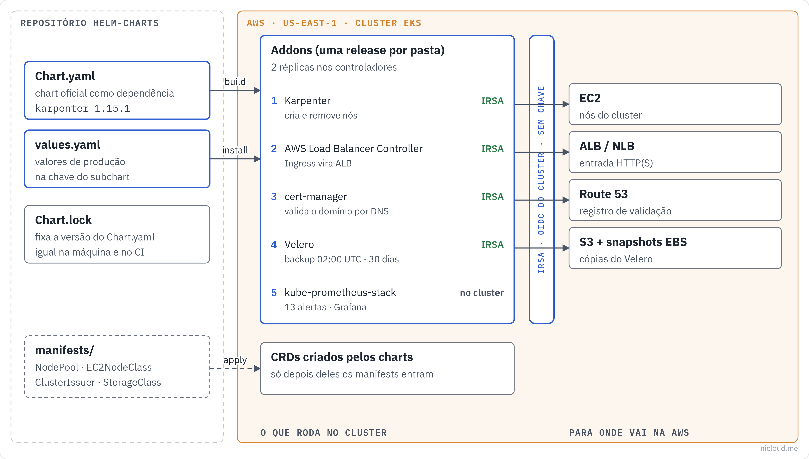

<!-- curso: Nicloud · Kubernetes na AWS -->
# Módulo 1 – Helm e o padrão wrapper chart

## Objetivos de aprendizagem

Neste módulo, você vai aprender a:

- Descrever o que é um **chart**, uma **release** e um **repositório** de charts.
- Reconhecer cada arquivo de um chart: `Chart.yaml`, `values.yaml`, `Chart.lock`, `charts/` e `ci/`.
- Explicar o padrão **wrapper chart** e por que ele deixa a atualização de addons barata.
- Diferenciar `helm dependency build` de `helm dependency update` e fixar versões de forma segura.
- Sobrescrever valores de um **subchart** e prever qual valor vence quando há vários arquivos.
- Conduzir o ciclo de vida de uma release: instalar, atualizar, ver histórico, voltar e remover.
- Explicar por que **CRDs** e os manifests que dependem deles exigem uma ordem de instalação.
- Testar todos os charts com `helm lint` e `helm template` num pipeline de CI.

## Arquitetura

Visão geral do que este repositório faz, no padrão de diagrama da Nicloud: à esquerda quem chama, no meio as regras, à direita para onde vai. Este módulo cobre a base que todos os addons usam. Os módulos 2, 3 e 4 entram em cada addon.



## Helm, chart e release

O <u>**Helm**</u> é o gerenciador de pacotes do Kubernetes. Ele pega um pacote de templates, preenche com os seus valores e entrega os manifests prontos para a API do cluster.

O pacote se chama <u>**chart**</u>. Cada instalação de um chart num cluster vira uma <u>**release**</u>, com nome próprio (`karpenter`, `cert-manager`) e um **histórico de revisões**. Cada `helm upgrade` cria uma revisão nova, e o Helm guarda o que foi aplicado em cada uma. É isso que permite voltar no tempo com `helm rollback`.

Os charts ficam publicados num <u>**repositório**</u>. Existem dois tipos: o repositório **HTTP** clássico (um `index.yaml` num servidor, como `https://charts.jetstack.io`) e o registro **OCI**, o mesmo padrão das imagens de container (como `oci://public.ecr.aws/karpenter`).

### Quando usar

Use Helm para software de terceiros que você vai instalar em mais de um cluster e atualizar várias vezes: Karpenter, cert-manager, Prometheus, Velero. O mantenedor já resolveu RBAC, CRDs, probes e upgrades dentro do chart.

Para dois ou três manifests seus, que mudam pouco, `kubectl apply` ou Kustomize são mais simples. Helm cobra o preço de uma camada de template.

## Anatomia de um chart

Um chart é uma pasta com arquivos de nome fixo:

| Arquivo ou pasta | Para que serve |
|---|---|
| `Chart.yaml` | Nome, versão do chart, versão do software (`appVersion`) e dependências |
| `values.yaml` | Os valores padrão que quem instala pode trocar |
| `templates/` | Os manifests com marcações `{{ }}` que o Helm preenche |
| `charts/` | Os charts das dependências, baixados em `.tgz` |
| `Chart.lock` | A versão exata de cada dependência, gravada pelo Helm |
| `crds/` | CRDs instalados antes de tudo, só na primeira instalação |
| `ci/*-values.yaml` | Valores extras usados só nos testes |

O `Chart.yaml` tem duas versões que confundem: `version` é a versão **do chart** (do empacotamento) e `appVersion` é a versão **do software** que ele instala. Neste repositório o wrapper fica em `0.1.0` e o `appVersion` acompanha o addon.

## Exemplo: anatomia neste repo

A pasta `karpenter/` tem tudo o que um addon precisa e nada além disso:

```text
karpenter/
├── Chart.yaml          # declara o chart oficial como dependência
├── Chart.lock          # versão exata baixada
├── charts/
│   └── karpenter-1.15.1.tgz
├── values.yaml         # só os valores de produção
├── manifests/          # aplicados depois do chart
│   ├── default-nodepool.yaml
│   └── ec2nodeclass.yaml
└── README.md
```

Repare que não existe `templates/`. Quem traz os templates é o chart oficial, dentro do `.tgz`.

## Wrapper chart

Este repositório não copia os charts oficiais. Cada pasta é um <u>**wrapper chart**</u>: um chart pequeno que declara o chart oficial como **dependência** e guarda só os valores de produção.

Copiar o chart oficial para dentro do repositório (o famoso "fork do chart") parece dar controle, mas cobra caro depois. Cada versão nova vira um merge manual de centenas de templates. No wrapper, atualizar um addon é trocar um número no `Chart.yaml` e revisar o diff dos valores.

O wrapper também resolve a pergunta "o que mudamos em relação ao padrão?". A resposta é exatamente o `values.yaml`, curto e revisável.

## Exemplo: o wrapper do Karpenter

```yaml
# karpenter/Chart.yaml
apiVersion: v2
name: karpenter
version: 0.1.0
appVersion: "1.15.1"
dependencies:
  - name: karpenter
    version: "1.15.1"
    repository: "oci://public.ecr.aws/karpenter"
```

### Como funciona

#### (1) Baixar a dependência

`helm dependency build karpenter` lê o `Chart.yaml` e o `Chart.lock` e baixa o `.tgz` do registro OCI para `karpenter/charts/`.

#### (2) Instalar com os valores de produção

`helm install karpenter . -n karpenter --create-namespace -f values.yaml` instala o wrapper. Como o wrapper não tem templates, quem gera os recursos é o subchart `karpenter`, com os valores daqui.

## Dependências e versões fixas

Os dois comandos de dependência fazem coisas diferentes:

- `helm dependency build` respeita o **Chart.lock**. Baixa exatamente as versões gravadas. É o comando do dia a dia e do CI.
- `helm dependency update` ignora o lock, resolve as versões do `Chart.yaml` de novo e **reescreve** o lock. É o comando de quando você quer atualizar.

Se o `Chart.yaml` muda e o lock não, o Helm recusa com "the lock file (Chart.lock) is out of sync". É uma proteção: impede que alguém troque a versão sem registrar.

A versão no `Chart.yaml` aceita intervalos (`~1.16.0`, `>=1.0.0`, `"*"`). Em addon de produção, fixe a versão exata. Intervalo faz o mesmo commit instalar coisas diferentes em dias diferentes.

## Exemplo: a versão "*" do Linkerd

Até novembro de 2026, os dois charts do Linkerd usavam `version: "*"` apontando para o canal `edge`, que publica versões novas toda semana. Cada `helm dependency update` podia trazer um control plane diferente, sem ninguém pedir.

```yaml
# linkerd/linkerd-control-plane/Chart.yaml
dependencies:
  - name: linkerd-control-plane
    version: "2026.11.1"
    repository: https://helm.linkerd.io/edge
```

A correção fixou a versão, gerou o `Chart.lock` e guardou o `.tgz` em `charts/`. Agora atualizar o Linkerd é uma decisão com commit, não um efeito colateral.

## Valores do subchart

Os valores do chart oficial ficam **dentro de uma chave com o nome da dependência**. O wrapper repassa para o subchart só o que está debaixo dessa chave.

```yaml
# cert-manager/values.yaml
cert-manager:          # nome da dependência no Chart.yaml
  crds:
    enabled: true
  replicaCount: 2
```

Se você escrever `replicaCount: 2` na raiz, o valor fica no wrapper, o cert-manager nunca vê e continua com uma réplica. O `helm lint` não acusa, porque para ele é só um valor que ninguém usa.

### Quem vence quando há vários valores

O Helm junta os valores nesta ordem, e o último vence:

1. `values.yaml` do chart oficial (dentro do `.tgz`)
2. `values.yaml` do wrapper
3. Cada `-f arquivo.yaml`, na ordem em que aparecem
4. Cada `--set chave=valor`

O script de testes usa exatamente isso: passa `-f values.yaml` e depois `-f ci/test-values.yaml`, para o valor de teste ganhar.

## Placeholders: o que trocar antes de instalar

Os `values.yaml` vêm com marcadores em maiúsculas para tudo o que depende do seu ambiente:

| Marcador | Onde aparece | Troque por |
|---|---|---|
| `CLUSTER_NAME` | Karpenter, ALB, ExternalDNS, Fluent Bit | Nome do cluster EKS |
| `CLUSTER_ENDPOINT` | Karpenter | Endpoint da API do cluster |
| `ACCOUNT_ID` e `*_ROLE_NAME` | anotações de IRSA | ARN da role do IAM do addon |
| `vpc-xxxxxxxxxxxxxxxxx` | ALB | ID da VPC do cluster |
| `CHANGE_ME` | Velero, Fluent Bit, Linkerd | Bucket, role, certificado |
| `example.com` | ExternalDNS, Uptime Kuma, cert-manager | Seu domínio e e-mail |

Antes do `helm install`, um `grep -rn "CHANGE_ME\|CLUSTER_NAME\|ACCOUNT_ID" <addon>/` mostra o que ainda falta. Senha e webhook nunca ficam no `values.yaml` versionado. O Grafana e o Alertmanager deste repositório já leem a senha e o webhook do Slack de Secrets criados fora do Git (módulo 4).

## IRSA: permissão AWS sem chave

O <u>**IRSA**</u> (IAM Roles for Service Accounts) liga a **service account** do pod a uma **role do IAM**. O pod recebe credenciais temporárias pelo provedor **OIDC** do cluster, sem access key guardada em Secret.

Do lado do Kubernetes, toda a ligação é uma anotação:

```yaml
# karpenter/values.yaml
karpenter:
  serviceAccount:
    annotations:
      eks.amazonaws.com/role-arn: "arn:aws:iam::ACCOUNT_ID:role/KARPENTER_ROLE_NAME"
```

Do lado da AWS, a role precisa de uma **trust policy** que confie no OIDC do cluster e, de preferência, só naquela service account (`system:serviceaccount:<namespace>:<nome>`). Sem essa trava, qualquer pod do cluster pode assumir a role.

### Quem usa IRSA neste repo

| Addon | Para que precisa da AWS |
|---|---|
| Karpenter | criar e remover instâncias EC2 |
| AWS Load Balancer Controller | criar ALB, NLB e target groups |
| ExternalDNS | criar e apagar registros no Route 53 |
| cert-manager | criar o registro TXT do desafio DNS-01 no Route 53 |
| Velero | gravar backup no S3 e criar snapshot de EBS |
| Fluent Bit | enviar logs para o CloudWatch Logs |

A alternativa mais nova é o **EKS Pod Identity**, que dispensa o OIDC por cluster. Os charts aqui usam IRSA porque funciona em qualquer versão do EKS.

## Ciclo de vida de uma release

Os comandos que você vai usar com cada addon:

| Comando | O que faz |
|---|---|
| `helm install <nome> . -n <ns> -f values.yaml` | Cria a release (revisão 1) |
| `helm upgrade --install <nome> . -n <ns> -f values.yaml` | Instala se não existe, atualiza se existe |
| `helm list -n <ns>` | Lista as releases e a revisão atual |
| `helm history <nome> -n <ns>` | Mostra todas as revisões e o status de cada uma |
| `helm rollback <nome> <revisão> -n <ns>` | Volta para uma revisão anterior (criando uma nova) |
| `helm uninstall <nome> -n <ns>` | Remove os recursos da release |
| `helm get values <nome> -n <ns>` | Mostra os valores aplicados na release |

Duas opções valem para produção. Com `--wait`, o Helm só considera a release pronta quando os pods ficam prontos. Com `--atomic`, se der errado, ele volta sozinho para a revisão anterior.

### CRDs não acompanham o upgrade

Os CRDs da pasta `crds/` de um chart são instalados só no **primeiro** `helm install`. Em `helm upgrade` o Helm não toca neles, e em `helm uninstall` também não os apaga, para não apagar junto todos os recursos daquele tipo.

Por isso alguns charts oferecem os CRDs como template comum, ligados por um valor. É o caso do `crds.enabled: true` do cert-manager: assim os CRDs são atualizados junto com o chart.

## Exemplo: atualizar um addon

O fluxo para subir o cert-manager de versão:

```bash
cd cert-manager
# 1. trocar a versão da dependência no Chart.yaml
# 2. regravar o lock e baixar o novo .tgz
helm dependency update
# 3. ver o que muda antes de aplicar
helm template cert-manager . -f values.yaml > novo.yaml
# 4. testar o repositório inteiro
../scripts/test-charts.sh
# 5. aplicar com volta automática se falhar
helm upgrade --install cert-manager . -n cert-manager -f values.yaml --wait --atomic
```

Antes do passo 5, leia as notas de versão do addon. Mudança de versão principal costuma renomear valores, e valor com nome antigo é ignorado em silêncio.

## Manifests depois do chart

Algumas pastas têm `manifests/` para aplicar com `kubectl` **depois** do chart:

| Pasta | Manifests | Tipo que exige o chart antes |
|---|---|---|
| `karpenter/` | NodePool, EC2NodeClass | CRDs do Karpenter |
| `cert-manager/` | ClusterIssuer | CRDs do cert-manager |
| `calico/` | NetworkPolicy default-deny | Calico aplicando as políticas |
| `prometheus-stack/` | regras de alerta, Alertmanager, dashboards | CRDs do Prometheus Operator |
| `secrets-csi/` | SecretProviderClass | CRDs do driver CSI |
| `storage/` | StorageClasses gp3 e EFS | drivers CSI do EBS e do EFS |

A ordem importa porque esses recursos usam **tipos novos** que só existem depois que o chart instala os CRDs. Aplicar antes dá "no matches for kind NodePool".

## Ordem de instalação

Uma ordem que evita a maior parte das surpresas:

1. `storage`: os outros addons pedem volume `gp3`.
2. `karpenter`: os outros addons precisam de nós.
3. `ingress-alb` e `external-dns`: balanceador e DNS.
4. `cert-manager`: os certificados dependem de DNS.
5. O resto, em qualquer ordem: ingress, malha, segredos, observabilidade, ArgoCD e Velero.

No Istio, instale `istio-base` antes do `istiod`. No Linkerd, `linkerd-crds` antes do `linkerd-control-plane`. A pasta de cima (`istio/`, `linkerd/`) é só um guarda-chuva com o README.

Depois que o ArgoCD estiver de pé, ele pode assumir todos os outros addons, com uma `Application` por pasta (módulo 4).

## Testes: lint e template

Dois comandos do Helm testam um chart sem cluster:

- `helm lint` confere a estrutura: `Chart.yaml` válido, templates que compilam, valores obrigatórios.
- `helm template` gera os manifests finais na tela. Se um template falha, ou se um valor obrigatório falta, o erro aparece aqui.

Nenhum dos dois prova que o addon funciona no cluster. Eles pegam o erro mais comum: valor com nome errado, YAML quebrado, dependência que não foi baixada, versão fora do lock.

## Exemplo: o script e o CI deste repo

```bash
# scripts/test-charts.sh (trecho)
for dir in $(find . -name Chart.yaml -not -path '*/charts/*' -printf '%h\n' | sort); do
  args=()
  [ -f "$dir/values.yaml" ] && args+=(-f "$dir/values.yaml")
  for v in "$dir"/ci/*-values.yaml; do [ -f "$v" ] && args+=(-f "$v"); done
  helm lint "$dir" "${args[@]}" && helm template ci "$dir" "${args[@]}"
done
```

O script acha os **24 charts** (os 20 addons mais os subcharts do Istio e do Linkerd), roda os dois comandos em cada um e depois confere se os 10 arquivos de `manifests/` são YAML válido. O workflow `.github/workflows/ci.yml` roda o script em todo push e pull request e, no CI, ainda valida cada manifest gerado contra o esquema da API do Kubernetes com o **kubeconform**. Um campo com nome errado num Deployment, por exemplo, para o CI.

O Linkerd precisa de certificados para gerar os manifests. O arquivo `linkerd/linkerd-control-plane/ci/test-values.yaml` passa certificados falsos, só para o teste. Nunca use esse arquivo num cluster.

## Resumo

O **Helm** empacota software para Kubernetes em **charts**. Cada instalação vira uma **release** com histórico, e é esse histórico que deixa você atualizar com `helm upgrade` e voltar com `helm rollback`. Os charts vêm de **repositórios** HTTP ou de registros **OCI**.

Este repositório usa **wrapper charts**: cada addon declara o chart oficial como dependência e guarda só os valores de produção, sempre dentro da chave com o nome da dependência. Atualizar vira trocar a versão no `Chart.yaml` e rodar `helm dependency update`, e o **Chart.lock** garante que o CI e a sua máquina instalem a mesma coisa. Versão aberta como `"*"` não tem lugar em produção, como mostrou o Linkerd.

Os addons que falam com a AWS usam **IRSA**, com uma role por addon e a trust policy presa à service account. Os **CRDs** pedem atenção duas vezes: os manifests que usam tipos novos só entram depois do chart, e o Helm não atualiza CRDs da pasta `crds/` num upgrade.

Por fim, `helm lint` e `helm template` rodam em todo push para os 24 charts. Eles não substituem um teste em cluster, mas pegam a maior parte dos erros antes de alguém digitar `helm upgrade`.

## Quiz

Você precisa atualizar o cert-manager para a versão nova. O que muda no repositório?

- A versão da dependência no `Chart.yaml`, o `Chart.lock` e o `.tgz` em `charts/` (com `helm dependency update`). Os templates continuam sendo os do mantenedor, porque o wrapper não tem templates próprios.

Você colocou `replicaCount: 2` na raiz do `values.yaml` do wrapper e o cert-manager continua com uma réplica. Por quê?

- O valor precisa ficar dentro da chave `cert-manager:`, que é o nome da dependência. Na raiz, ele pertence ao wrapper e nunca chega ao subchart.

O CI falhou com "the lock file (Chart.lock) is out of sync with the dependencies file". O que aconteceu?

- Alguém trocou a versão no `Chart.yaml` sem rodar `helm dependency update`. O lock protege contra mudança de versão sem registro.

Qual a diferença entre `helm dependency build` e `helm dependency update`?

- `build` baixa as versões gravadas no lock e é o comando do dia a dia. `update` resolve as versões de novo e reescreve o lock, e é o comando de quando se quer atualizar.

O chart está em `version: 0.1.0` e `appVersion: "1.15.1"`. Qual versão do Karpenter vai rodar?

- A 1.15.1. O `version` é a versão do empacotamento (o wrapper). O `appVersion` e a dependência indicam a versão do software.

`kubectl apply -f karpenter/manifests/default-nodepool.yaml` falhou com "no matches for kind NodePool". O que faltou?

- Instalar o chart do Karpenter antes. Ele cria o CRD `NodePool`, e sem o CRD a API não conhece esse tipo.

Você roda `helm template` com `-f values.yaml -f ci/test-values.yaml` e os dois definem a mesma chave. Qual valor vence?

- O do `ci/test-values.yaml`. Os arquivos `-f` são aplicados na ordem, e o último vence.

Um upgrade deixou os pods do addon em CrashLoop. Qual o caminho mais rápido de volta?

- `helm history` para achar a última revisão boa e `helm rollback <nome> <revisão>`. Com `--atomic` no upgrade, o Helm teria voltado sozinho.

Por que a role do IAM do Velero deve confiar só em `system:serviceaccount:velero:velero-server`, e não em todo o OIDC do cluster?

- Para que só o pod do Velero assuma a role. Sem a trava, qualquer pod do cluster poderia ler e apagar os backups.

## Recursos adicionais

- [Charts (documentação do Helm)](https://helm.sh/docs/topics/charts/)
- [helm dependency](https://helm.sh/docs/helm/helm_dependency/)
- [Boas práticas de values](https://helm.sh/docs/chart_best_practices/values/)
- [CRDs no Helm](https://helm.sh/docs/chart_best_practices/custom_resource_definitions/)
- [helm upgrade](https://helm.sh/docs/helm/helm_upgrade/)
- [IAM roles for service accounts (EKS)](https://docs.aws.amazon.com/eks/latest/userguide/iam-roles-for-service-accounts.html)
- [EKS Pod Identity](https://docs.aws.amazon.com/eks/latest/userguide/pod-identities.html)
