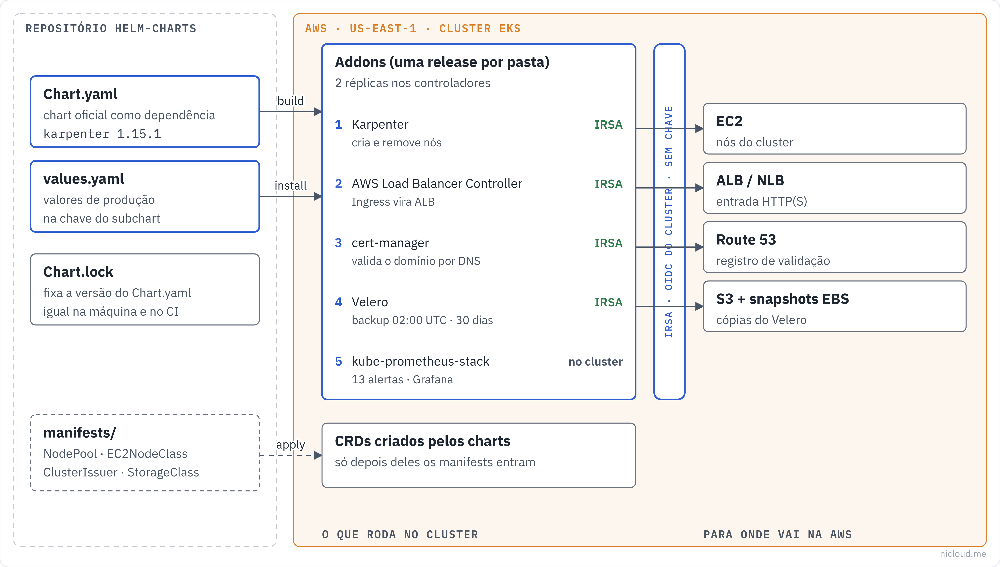

<!-- curso: Nicloud · Kubernetes na AWS -->
# Módulo 2 – Escala, armazenamento e entrada de tráfego

## Objetivos de aprendizagem

Neste módulo, você vai aprender a:

- Explicar como o **Karpenter** escolhe, cria e remove nós a partir de um **NodePool** e de um **EC2NodeClass**.
- Configurar **StorageClasses** gp3 e EFS e escolher entre `ReadWriteOnce` e `ReadWriteMany`.
- Descrever o que o **AWS Load Balancer Controller** cria na AWS a partir de um Ingress ou de um Service.
- Comparar ingress-nginx, Envoy Gateway, Traefik, Kong e ALB e escolher um para cada caso.
- Diferenciar a API **Ingress** da **Gateway API**.
- Publicar registros no Route 53 automaticamente com o **ExternalDNS** sem apagar o que não é dele.
- Emitir certificados TLS com o **cert-manager** usando o desafio **DNS-01** no Route 53.

## Arquitetura

O diagrama mostra o caminho de uma requisição: da Internet ao balanceador, do balanceador ao controlador de entrada e dele aos pods. Este módulo cobre tudo o que fica nesse caminho, mais os nós e os discos onde os pods rodam.



## Karpenter: nós sob demanda

O <u>**Karpenter**</u> é o autoscaler de nós do EKS. Ele observa os pods que ficaram **Pending** por falta de espaço, calcula o que eles pedem (CPU, memória, arquitetura, zona) e cria a instância EC2 que melhor serve, em segundos.

A diferença para o Cluster Autoscaler clássico é que o Karpenter não depende de grupos de nós com tipo de instância fixo. Ele escolhe o tipo na hora, entre dezenas de famílias, e também faz o caminho de volta: junta pods em menos nós e desliga o que sobra. Isso se chama **consolidação**.

O chart instala só o **controlador**. O que ele pode criar é definido por dois recursos que você aplica depois: o **NodePool** (que tipo de nó) e o **EC2NodeClass** (como lançar o nó na AWS).

## Exemplo: o controlador do Karpenter neste repo

```yaml
# karpenter/values.yaml
karpenter:
  serviceAccount:
    annotations:
      eks.amazonaws.com/role-arn: "arn:aws:iam::ACCOUNT_ID:role/KARPENTER_ROLE_NAME"
  replicas: 2
  settings:
    clusterName: "CLUSTER_NAME"
    clusterEndpoint: "CLUSTER_ENDPOINT"
  logLevel: info
```

- `replicas: 2`: um controlador fica ativo e o outro de reserva (eleição de líder). Se o nó do primeiro cair, o segundo assume.
- A role do IRSA precisa criar e encerrar instâncias, passar a role do nó (`iam:PassRole`) e ler a fila de interrupção de Spot.
- Os dois controladores não podem rodar em nós criados pelo próprio Karpenter. Se o Karpenter derrubar o nó onde ele mesmo roda, ninguém cria o próximo. Rode-os num grupo de nós gerenciado pequeno ou no Fargate.

## NodePool e EC2NodeClass

O <u>**NodePool**</u> diz **que nós** podem ser criados: capacidade (Spot ou sob demanda), famílias de instância, arquitetura, limites e regras de consolidação.

```yaml
# karpenter/manifests/default-nodepool.yaml (trecho)
spec:
  template:
    spec:
      requirements:
        - key: karpenter.sh/capacity-type
          operator: In
          values: ["on-demand", "spot"]
        - key: karpenter.k8s.aws/instance-family
          operator: In
          values: ["c", "m", "r"]
        - key: kubernetes.io/arch
          operator: In
          values: ["amd64"]
  limits:
    cpu: "100"
  disruption:
    consolidationPolicy: WhenEmptyOrUnderutilized
    consolidateAfter: 30s
```

- Com Spot e sob demanda liberados, o Karpenter prefere **Spot** quando há capacidade, por ser mais barato, e cai para sob demanda quando não há.
- `limits.cpu: "100"` é o teto do NodePool: a soma das vCPUs de todos os nós dele não passa de 100. É a trava contra um deploy com erro que pede mil réplicas.
- `WhenEmptyOrUnderutilized` com `consolidateAfter: 30s` remove nós vazios e troca nós subutilizados por menores, 30 segundos depois de a situação aparecer.

O <u>**EC2NodeClass**</u> diz **como lançar** o nó: imagem, sub-redes, security groups e role.

```yaml
# karpenter/manifests/ec2nodeclass.yaml (trecho)
spec:
  amiSelectorTerms:
    - alias: al2023@latest
  subnetSelectorTerms:
    - tags:
        karpenter.sh/discovery: "CLUSTER_NAME"
  role: "KarpenterNodeRole-CLUSTER_NAME"
```

O Karpenter descobre sub-redes e security groups pela **tag** `karpenter.sh/discovery`. Esquecer de marcar as sub-redes privadas com essa tag é o erro mais comum na primeira instalação: o NodePool existe, mas nenhum nó nasce.

### Quando não usar

`al2023@latest` sempre pega a AMI mais nova, o que pode trocar a imagem dos nós sem aviso a cada consolidação. Em produção mais conservadora, fixe uma versão (`al2023@v20261101`) e atualize de propósito.

Os CRDs do Karpenter vêm na pasta `crds/` do chart, e o Helm não os atualiza num `helm upgrade` (módulo 1). Ao subir de versão principal, aplique os CRDs novos antes, ou instale o chart `karpenter-crd` separado, que é feito para isso.

## Armazenamento: StorageClasses

Uma <u>**StorageClass**</u> diz ao Kubernetes como criar um disco quando um pod pede um volume (um **PersistentVolumeClaim**). A pasta `storage/` não tem chart, só duas StorageClasses.

```yaml
# storage/manifests/gp3-storageclass.yaml
metadata:
  name: gp3
  annotations:
    storageclass.kubernetes.io/is-default-class: "true"
provisioner: ebs.csi.aws.com
volumeBindingMode: WaitForFirstConsumer
parameters:
  type: gp3
  encrypted: "true"
allowVolumeExpansion: true
```

- **gp3** é o disco EBS padrão: mais barato que o gp2 e com desempenho que não depende do tamanho.
- `WaitForFirstConsumer` espera o pod ser agendado antes de criar o disco. Um volume EBS vive numa zona só. Se o disco nascesse antes, poderia ficar numa zona onde o pod não roda.
- `encrypted: "true"` criptografa com a chave padrão do EBS.
- `allowVolumeExpansion` permite aumentar o PVC sem recriar o disco.

A `efs` (EFS) atende o caso que o EBS não atende: vários pods, em zonas diferentes, lendo e escrevendo o mesmo volume (`ReadWriteMany`). Com `provisioningMode: efs-ap`, cada PVC vira um **access point** num sistema de arquivos EFS que você cria antes (`fileSystemId`).

| | gp3 (EBS) | efs (EFS) |
|---|---|---|
| Acesso | um nó por vez (`ReadWriteOnce`) | muitos nós (`ReadWriteMany`) |
| Zona | uma | todas da região |
| Uso típico | banco, Prometheus, Vault | arquivos compartilhados, uploads |
| Driver | EBS CSI (addon do EKS) | EFS CSI (instalado à parte) |

## AWS Load Balancer Controller

O <u>**AWS Load Balancer Controller**</u> (pasta `ingress-alb/`) observa o cluster e cria balanceadores na AWS:

- um **ALB** para cada Ingress com a classe `alb` (ou um ALB compartilhado por vários, com `group.name`);
- um **NLB** para cada Service do tipo `LoadBalancer` com a anotação `aws-load-balancer-type: external`.

```yaml
# ingress-alb/values.yaml
aws-load-balancer-controller:
  clusterName: "CLUSTER_NAME"
  serviceAccount:
    annotations:
      eks.amazonaws.com/role-arn: "arn:aws:iam::ACCOUNT_ID:role/ALB_CONTROLLER_ROLE_NAME"
  region: "us-east-1"
  vpcId: "vpc-xxxxxxxxxxxxxxxxx"
```

Este controlador é a base dos outros ingress do repositório. O NGINX, o Traefik e o Kong pedem um NLB com as mesmas três anotações:

```yaml
# ingress-nginx/values.yaml (trecho)
service:
  type: LoadBalancer
  annotations:
    service.beta.kubernetes.io/aws-load-balancer-type: external
    service.beta.kubernetes.io/aws-load-balancer-scheme: internet-facing
    service.beta.kubernetes.io/aws-load-balancer-nlb-target-type: ip
```

Com `nlb-target-type: ip`, o NLB manda o tráfego direto para o IP do pod, sem passar pela porta do nó. Isso funciona porque, no EKS, o **VPC CNI** dá a cada pod um IP real da VPC. Sem o controlador instalado, essas anotações não fazem nada, e o Service fica esperando um balanceador que nunca chega.

## Ingress e Gateway API

O <u>**Ingress**</u> é a API antiga do Kubernetes para rotear HTTP: host e caminho levam a um Service. Ela é simples, mas pequena. Tudo o que vai além (timeout, reescrita, autenticação) vira **anotação** específica de cada controlador, e trocar de controlador obriga a reescrever as anotações.

A <u>**Gateway API**</u> é a substituta. Ela divide o trabalho em três recursos com donos diferentes:

| Recurso | Quem cuida | O que define |
|---|---|---|
| `GatewayClass` | quem instala o controlador | qual implementação (Envoy, Istio, Kong…) |
| `Gateway` | o time de plataforma | porta, protocolo, certificado |
| `HTTPRoute` | o time da aplicação | host, caminho, pesos, cabeçalhos |

Divisão de tráfego por peso, cabeçalhos e espelhamento fazem parte da especificação, então funcionam igual em qualquer controlador.

## Os cinco controladores de entrada

O repositório traz cinco opções. A comparação completa está em `ingress-comparison.md`. O resumo:

| Controlador | Pasta | Configuração | Melhor para |
|---|---|---|---|
| AWS ALB | `ingress-alb/` | Ingress + anotações | Integração com WAF, Cognito e ACM, sem pod no caminho |
| ingress-nginx | `ingress-nginx/` | Ingress + anotações | Legado (ver aviso abaixo) |
| Envoy Gateway | `ingress-envoy/` | Gateway API | Projetos novos, padrão aberto |
| Traefik | `traefik/` | Ingress + IngressRoute | Ambientes dinâmicos, painel pronto |
| Kong | `kong/` | Ingress + plugins | API gateway: autenticação e rate limit por consumidor |

### ingress-nginx foi aposentado

Em novembro de 2025, o projeto Kubernetes anunciou a aposentadoria do **ingress-nginx**. A manutenção terminou em março de 2026, e desde então não sai versão nova nem correção de segurança. As instalações existentes continuam funcionando.

O chart continua no repositório para estudo e para clusters que ainda dependem dele. Para cluster novo, prefira o Envoy Gateway (Gateway API) ou o ALB.

```yaml
# ingress-nginx/values.yaml (trecho)
controller:
  replicaCount: 2
  metrics:
    enabled: true
  resources:
    requests: { cpu: 100m, memory: 128Mi }
    limits:   { cpu: 500m, memory: 512Mi }
```

### Envoy Gateway

```yaml
# ingress-envoy/values.yaml
gateway-helm: {}
```

O arquivo está vazio de propósito. Os valores padrão do Envoy Gateway já servem para produção, e o trabalho real fica nos recursos `GatewayClass`, `Gateway` e `HTTPRoute`. Um `values.yaml` vazio também é uma mensagem: "não mudamos nada do padrão".

### Traefik

```yaml
# traefik/values.yaml (trecho)
service:
  spec:
    type: LoadBalancer
providers:
  kubernetesIngress: { enabled: true }
  kubernetesCRD:     { enabled: true }
api:
  dashboard: true
ingressRoute:
  dashboard:
    enabled: false
```

O Traefik lê os dois formatos: o Ingress comum e o seu CRD próprio, o `IngressRoute`, que tem middlewares (autenticação, cabeçalhos, rate limit). O painel fica ligado (`api.dashboard`), mas **não é publicado** (`ingressRoute.dashboard.enabled: false`): acesse com `kubectl port-forward`. Repare também em `service.spec.type`: até o chart 32 era `service.type`. Na atualização para o chart 42, o nome antigo passou a ser ignorado em silêncio, e é por isso que valor com nome errado é o risco número um de um upgrade (módulo 1).

### Kong

```yaml
# kong/values.yaml (trecho)
ingressController:
  enabled: true
admin:
  enabled: false
serviceMonitor:
  enabled: true
```

- `admin.enabled: false` desliga a API de administração do Kong. Com o ingress controller ligado, a configuração vem do Kubernetes (CRDs como `KongPlugin`), e uma API de administração aberta seria uma porta a mais para atacar.
- `serviceMonitor.enabled: true` cria um ServiceMonitor para o Prometheus do módulo 4. Esse tipo só existe depois do `prometheus-stack`, então instale o Prometheus antes do Kong.

## ExternalDNS: registros automáticos

O <u>**ExternalDNS**</u> lê os Ingresses e Services do cluster e cria os registros DNS correspondentes no Route 53. Você publica `app.example.com` num Ingress, e o registro aparece apontando para o balanceador, sem abrir o console.

```yaml
# external-dns/values.yaml
external-dns:
  provider:
    name: aws
  domainFilters:
    - "example.com"
  policy: sync
  txtOwnerId: "CLUSTER_NAME"
```

- `domainFilters` limita as zonas que ele pode tocar. Sem filtro, ele age em todas as zonas que a role enxerga.
- `policy: sync` cria **e apaga** registros. Apagou o Ingress, o registro some. Use `upsert-only` se quiser que ele nunca apague, por exemplo durante uma migração.
- `txtOwnerId` marca cada registro com um TXT de dono. O ExternalDNS só apaga o que tem a marca dele. Isso protege os registros criados à mão e permite dois clusters na mesma zona sem um apagar o do outro, **desde que cada cluster use um ID diferente**.

## cert-manager: certificados automáticos

O <u>**cert-manager**</u> emite e renova certificados TLS dentro do cluster. Você descreve o que quer num recurso `Certificate` (ou numa anotação no Ingress), e ele conversa com a autoridade certificadora, guarda o certificado num Secret e renova antes de vencer.

Quem emite é definido num <u>**ClusterIssuer**</u>, aplicado depois do chart:

```yaml
# cert-manager/manifests/cluster-issuer.yaml (trecho)
kind: ClusterIssuer
metadata:
  name: letsencrypt-production
spec:
  acme:
    server: https://acme-v02.api.letsencrypt.org/directory
    email: "admin@example.com"
    solvers:
      - dns01:
          route53:
            hostedZoneID: "Z0XXXXXXXXXXXXX"
            region: "us-east-1"
```

### Como funciona

#### (1) Pedido

Um Ingress com a anotação `cert-manager.io/cluster-issuer: letsencrypt-production` pede um certificado para o seu host.

#### (2) Desafio DNS-01

O Let's Encrypt pede uma prova de que você controla o domínio. Com **DNS-01**, o cert-manager cria um registro TXT `_acme-challenge` no Route 53 (por isso a role de IRSA), o Let's Encrypt confere e o registro é apagado.

#### (3) Emissão e renovação

O certificado vai para um Secret, que o controlador de entrada usa. Certificados do Let's Encrypt valem 90 dias, e o cert-manager renova cerca de 30 dias antes do vencimento.

O **DNS-01** tem duas vantagens sobre o **HTTP-01**: funciona para serviços que não estão expostos na Internet e é o único que emite certificado **coringa** (`*.example.com`).

O nome do ClusterIssuer precisa bater em todo lugar que o usa. O Uptime Kuma deste repositório apontava para `letsencrypt-prod`, um emissor que não existe, e foi corrigido para `letsencrypt-production`. Com o nome errado, o certificado fica pendente para sempre, sem erro no Helm.

O Prometheus do módulo 4 tem o alerta `CertificateExpiringSoon`, que dispara quando falta menos de 7 dias para um certificado vencer. Se ele tocar, a renovação automática falhou dias antes.

## Resumo

O **Karpenter** cria nós sob medida para os pods pendentes e remove o que sobra. O chart instala o controlador, e o **NodePool** e o **EC2NodeClass** dizem o que ele pode criar: Spot ou sob demanda, famílias `c`, `m` e `r`, teto de 100 vCPUs e consolidação em 30 segundos. As sub-redes precisam da tag de descoberta, e o controlador não pode rodar em nós que ele mesmo gerencia.

Os discos vêm das **StorageClasses**: **gp3** criptografado e criado na zona do pod para quase tudo, **EFS** quando vários pods precisam do mesmo volume.

O **AWS Load Balancer Controller** é a base da entrada de tráfego: cria o ALB dos Ingresses e o NLB dos Services, e é dele que o NGINX, o Traefik e o Kong dependem. Entre os controladores, prefira a **Gateway API** (Envoy Gateway) ou o ALB em cluster novo, porque o **ingress-nginx** foi aposentado em março de 2026.

Por fim, o **ExternalDNS** publica os registros no Route 53 e só apaga o que marcou como seu, e o **cert-manager** emite e renova os certificados pelo desafio **DNS-01**, com um ClusterIssuer cujo nome precisa bater em todo lugar.

## Quiz

Você aplicou o NodePool e o EC2NodeClass, há pods Pending, e nenhum nó é criado. O log do Karpenter diz que não achou sub-redes. O que falta?

- Marcar as sub-redes privadas (e os security groups) com a tag `karpenter.sh/discovery: <cluster>`. É assim que o EC2NodeClass encontra onde lançar o nó.

Um deploy com erro pediu 2.000 réplicas. O que impede o Karpenter de criar centenas de nós?

- O `limits.cpu: "100"` do NodePool. A soma de vCPUs dos nós daquele NodePool não passa de 100.

Um pod com volume gp3 ficou Pending com erro de zona depois de ser reagendado. Qual opção da StorageClass evita o disco nascer na zona errada na criação?

- `volumeBindingMode: WaitForFirstConsumer`. O disco só é criado depois que o pod tem nó, na zona daquele nó.

Três pods em zonas diferentes precisam gravar no mesmo diretório. gp3 ou EFS?

- EFS, com `ReadWriteMany`. Um volume EBS fica numa zona só e aceita um nó por vez.

Você instalou o Traefik, e o Service `LoadBalancer` está sem endereço há dez minutos. Os eventos não mostram erro. O que provavelmente falta?

- O AWS Load Balancer Controller. As anotações `aws-load-balancer-type: external` só têm efeito com ele instalado.

Qual controlador de entrada você recomenda para um cluster novo em 2026 que precisa de divisão de tráfego por peso, e por quê não o ingress-nginx?

- Envoy Gateway, com Gateway API (`HTTPRoute` com pesos). O ingress-nginx foi aposentado em março de 2026 e não recebe mais correção de segurança.

Dois clusters publicam registros na mesma zona do Route 53 com o ExternalDNS, e um começou a apagar os registros do outro. O que está errado?

- Os dois usam o mesmo `txtOwnerId`. Cada cluster precisa de um ID próprio para só apagar o que criou.

Você precisa de um certificado `*.example.com` para um serviço interno, sem acesso pela Internet. Qual desafio ACME usar?

- DNS-01. O HTTP-01 exige que o Let's Encrypt acesse o serviço pela Internet e não emite certificado coringa.

O alerta `CertificateExpiringSoon` disparou. O que isso diz sobre a renovação?

- Que ela falhou: o cert-manager renova cerca de 30 dias antes, e o alerta só toca com menos de 7 dias. Olhe o recurso `Certificate` e os eventos do desafio.

## Recursos adicionais

- [Karpenter: NodePools](https://karpenter.sh/docs/concepts/nodepools/)
- [Karpenter: Disruption](https://karpenter.sh/docs/concepts/disruption/)
- [Amazon EBS CSI driver](https://docs.aws.amazon.com/eks/latest/userguide/ebs-csi.html)
- [Amazon EFS CSI driver](https://docs.aws.amazon.com/eks/latest/userguide/efs-csi.html)
- [AWS Load Balancer Controller](https://kubernetes-sigs.github.io/aws-load-balancer-controller/latest/)
- [Gateway API](https://gateway-api.sigs.k8s.io/)
- [Aposentadoria do ingress-nginx (blog do Kubernetes)](https://kubernetes.io/blog/2025/11/11/ingress-nginx-retirement/)
- [ExternalDNS na AWS](https://kubernetes-sigs.github.io/external-dns/latest/docs/tutorials/aws/)
- [cert-manager: ACME DNS-01 com Route 53](https://cert-manager.io/docs/configuration/acme/dns01/route53/)
