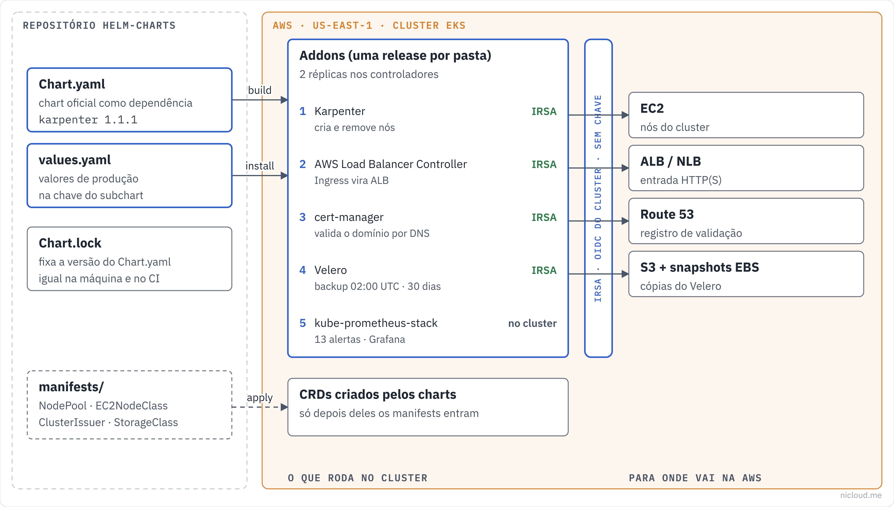

<!-- curso: Nicloud · Kubernetes na AWS -->
# Módulo 3 – Malha de serviços, rede e segredos

## Objetivos de aprendizagem

Neste módulo, você vai aprender a:

- Explicar o que uma **malha de serviços** acrescenta: **mTLS**, métricas por serviço e controle de tráfego.
- Instalar o **Istio** e o **Linkerd** na ordem certa e dizer quando escolher cada um.
- Descrever a cadeia de certificados do Linkerd (**trust anchor** e **issuer**) e por que ela não pode ficar no repositório.
- Aplicar **NetworkPolicies** com o **Calico** sobre o VPC CNI e montar o modelo "nega tudo, libera o necessário".
- Operar o **Vault** em alta disponibilidade com armazenamento **Raft**: iniciar, destrancar e juntar nós.
- Montar segredos do **Secrets Manager** como arquivo com o **Secrets Store CSI Driver**.
- Escolher entre Vault e Secrets Manager para cada tipo de segredo.

## Arquitetura

O diagrama mostra a visão geral. Este módulo cobre a camada que fica **entre** os pods: quem pode falar com quem (rede e malha) e com que credenciais (segredos).



## Malha de serviços

Uma <u>**malha de serviços**</u> (service mesh) coloca um **proxy** ao lado de cada pod, o **sidecar**. Todo o tráfego entre serviços passa pelos proxies, e isso dá três coisas sem mudar uma linha do código da aplicação:

- **mTLS** (TLS mútuo): cada pod ganha uma identidade com certificado, e a conexão entre dois pods é criptografada e autenticada dos dois lados.
- **Métricas douradas por serviço**: taxa de sucesso, latência e volume, entre cada par de serviços.
- **Controle de tráfego**: retentativas, timeouts, divisão por peso para canary.

O preço é um proxy a mais por pod (memória e alguns milissegundos) e uma peça a mais para operar. Se você só precisa bloquear tráfego entre namespaces, NetworkPolicy resolve sem malha.

## Istio

O <u>**Istio**</u> usa o **Envoy** como proxy e tem o conjunto mais completo de recursos: injeção de falhas, espelhamento de tráfego, autorização em L7, gateways de entrada e saída.

O repositório divide o Istio em dois charts, que precisam ser instalados nesta ordem:

| Ordem | Pasta | O que instala |
|---|---|---|
| 1 | `istio/istio-base` | CRDs e recursos do cluster |
| 2 | `istio/istiod` | o control plane, que configura os proxies e emite os certificados |

```yaml
# istio/istiod/values.yaml
istiod:
  pilot:
    resources:
      requests:
        cpu: 200m
        memory: 256Mi
  meshConfig:
    accessLogFile: /dev/stdout
```

- `pilot.resources` reserva CPU e memória para o istiod. Ele recalcula a configuração de todos os proxies a cada mudança, e sem reserva compete com as aplicações.
- `accessLogFile: /dev/stdout` liga o log de acesso dos proxies. Cada requisição vira uma linha no log do sidecar, que o Fluent Bit do módulo 4 leva para o CloudWatch. Ajuda muito no diagnóstico, mas aumenta o volume de logs.

Para colocar um namespace na malha: `kubectl label namespace <ns> istio-injection=enabled` e reiniciar os pods. O sidecar só é injetado na criação do pod.

## Linkerd

O <u>**Linkerd**</u> usa um proxy próprio, escrito em Rust, menor e mais simples que o Envoy. Ele liga mTLS sozinho em todo pod da malha e entrega as métricas douradas sem configuração.

Também são dois charts, nesta ordem:

| Ordem | Pasta | O que instala |
|---|---|---|
| 1 | `linkerd/linkerd-crds` | CRDs |
| 2 | `linkerd/linkerd-control-plane` | control plane e identidade |

### Cadeia de certificados

O mTLS do Linkerd depende de dois certificados que **você** gera antes de instalar:

- O <u>**trust anchor**</u>: a raiz da confiança da malha, de vida longa (por exemplo, 10 anos). Vai no `identityTrustAnchorsPEM`.
- O <u>**issuer**</u>: um certificado intermediário, assinado pelo trust anchor e de vida mais curta (por exemplo, 1 ano). O control plane usa o issuer para assinar o certificado de cada pod, que vale só 24 horas.

```yaml
# linkerd/linkerd-control-plane/values.yaml (trecho)
linkerd-control-plane:
  identityTrustAnchorsPEM: |
    -----BEGIN CERTIFICATE-----
    CHANGE_ME
    -----END CERTIFICATE-----
```

A chave privada do issuer **não** vai no `values.yaml` versionado. Passe na hora do install (`--set-file identity.issuer.tls.keyPEM=issuer.key`) ou, melhor, deixe o cert-manager gerar e renovar o issuer.

O teste do CI precisa gerar os manifests, então usa `ci/test-values.yaml` com certificados falsos. Eles fazem o `helm template` passar e não servem para nada além disso.

### Versão do Linkerd

O projeto Linkerd publica versões open source só no canal **edge**, com versão por data (`2026.11.1`). O repositório usava `version: "*"`, que trazia a versão mais nova a cada `helm dependency update`. Agora a versão está fixa, e atualizar é uma decisão com commit (módulo 1).

## Istio ou Linkerd

| | Istio | Linkerd |
|---|---|---|
| Proxy | Envoy (C++) | linkerd2-proxy (Rust) |
| Memória por sidecar | maior | menor |
| mTLS | automático | automático |
| Injeção de falhas, espelhamento | sim | não |
| Curva de aprendizado | longa | curta |
| Escolha quando | precisa de controle fino de tráfego ou já usa Envoy | quer mTLS e métricas com o mínimo de operação |

Não instale os dois no mesmo cluster. Os dois charts estão aqui para estudo e para escolher por cluster.

## Calico: políticas de rede

Por padrão, no Kubernetes, **todo pod fala com todo pod**. Uma <u>**NetworkPolicy**</u> restringe isso, mas o Kubernetes só guarda a regra. Quem aplica é o plugin de rede.

No EKS, a rede dos pods é do **VPC CNI** da AWS (cada pod tem IP da VPC). O <u>**Calico**</u> entra só como **motor de políticas**, sem trocar a rede:

```yaml
# calico/values.yaml
tigera-operator:
  installation:
    kubernetesProvider: EKS
    cni:
      type: AmazonVPC
```

- `cni.type: AmazonVPC` diz ao Calico para manter o VPC CNI e só aplicar as políticas. Trocar o CNI do EKS é outra conversa, bem mais arriscada.
- O chart instala o **tigera-operator**, que por sua vez instala e atualiza o Calico.

O EKS também tem aplicação de NetworkPolicy no próprio VPC CNI. O Calico continua útil quando você precisa das políticas próprias dele (`GlobalNetworkPolicy`, regras por DNS), que vão além da API padrão.

## Exemplo: nega tudo, libera o necessário

```yaml
# calico/manifests/default-deny.yaml
apiVersion: networking.k8s.io/v1
kind: NetworkPolicy
metadata:
  name: default-deny-ingress
  namespace: default
spec:
  podSelector: {}
  policyTypes:
    - Ingress
```

- `podSelector: {}` seleciona **todos** os pods do namespace.
- `policyTypes: [Ingress]` sem nenhuma regra `ingress` significa: nenhuma entrada é permitida.

A partir daí, cada serviço ganha uma política que libera só quem precisa falar com ele. Repare que esta política fecha só a **entrada**. A saída continua livre. Para fechar a saída também, inclua `Egress` e lembre de liberar o DNS (porta 53 para o CoreDNS), senão nenhum pod resolve nome.

## Vault em alta disponibilidade

O <u>**Vault**</u>, da HashiCorp, guarda segredos e também os **gera sob demanda**: senha de banco que vale uma hora, certificado de uma PKI interna, credencial temporária da AWS. Esse é o diferencial em relação a um cofre de valores fixos.

```yaml
# vault/values.yaml (trecho)
vault:
  server:
    ha:
      enabled: true
      replicas: 3
      raft:
        enabled: true
        setNodeId: true
    dataStorage:
      size: 10Gi
      storageClass: gp3
    auditStorage:
      enabled: true
      size: 10Gi
  injector:
    enabled: true
  ui:
    enabled: true
    serviceType: ClusterIP
```

- `ha.replicas: 3` com **Raft**: os três pods replicam os dados entre si, sem um Consul separado. Um é o líder e os outros acompanham. Três é o mínimo para o cluster continuar de pé com um nó fora, porque o Raft precisa de maioria (2 de 3).
- `dataStorage` e `auditStorage` criam um volume **gp3** por pod para os dados e outro para o **log de auditoria**, que registra cada acesso a segredo.
- `injector.enabled` liga o **Agent Injector**: com anotações no pod, um sidecar busca o segredo no Vault e grava em arquivo para a aplicação ler.
- `ui.serviceType: ClusterIP` mantém a interface fora da Internet. Acesse com `kubectl port-forward`.

Até novembro de 2026, este `values.yaml` ligava o HA sem ligar o Raft, embora o README dissesse "HA com Raft". O `helm template` passava, mas os pods não teriam onde guardar os dados em conjunto. É o tipo de erro que lint e template não pegam: o chart é válido, a configuração é que está incompleta.

### Como funciona

#### (1) Iniciar

`vault operator init` no primeiro pod gera as **chaves de destrave** (unseal keys) e o token raiz. Guarde as chaves separadas, com pessoas diferentes.

#### (2) Destrancar

Todo pod do Vault nasce **selado**: os dados estão criptografados e ele não responde. `vault operator unseal`, com o número mínimo de chaves, destranca. Isso se repete a cada reinício de pod.

#### (3) Juntar os outros nós

`vault operator raft join http://vault-0.vault-internal:8200` nos pods 1 e 2, e depois destrancar cada um. `vault operator raft list-peers` mostra os três.

Destrancar à mão a cada reinício não escala. Em produção, use o **auto-unseal** com o AWS KMS: o Vault pede ao KMS para destrancar, com uma role de IRSA, e reinicia sozinho.

## Secrets Store CSI Driver

O <u>**Secrets Store CSI Driver**</u> monta segredos de um cofre externo como **arquivos** dentro do pod. Na AWS, junto com o provedor da AWS, ele lê o **Secrets Manager** e o **Parameter Store**.

```yaml
# secrets-csi/values.yaml
secrets-store-csi-driver:
  syncSecret:
    enabled: true
  enableSecretRotation: true
```

- `syncSecret.enabled` permite copiar o segredo também para um Secret do Kubernetes, para quem precisa dele como variável de ambiente.
- `enableSecretRotation` relê o cofre de tempos em tempos e atualiza o arquivo montado quando o segredo muda.

O que montar é descrito numa <u>**SecretProviderClass**</u>:

```yaml
# secrets-csi/manifests/example-spc.yaml (trecho)
kind: SecretProviderClass
spec:
  provider: aws
  parameters:
    objects: |
      - objectName: "arn:aws:secretsmanager:us-east-1:123456789012:secret:my-secret"
        objectType: "secretsmanager"
```

O chart instala só o driver. O **provedor da AWS** (`secrets-store-csi-driver-provider-aws`) é instalado à parte, como mostra o README da pasta. Quem lê o segredo é o **pod da aplicação**, então é a service account dele que precisa de IRSA com `secretsmanager:GetSecretValue` naquele segredo.

Com `syncSecret`, o valor volta a existir num Secret do Kubernetes, que fica no etcd e pode ser lido por quem tem acesso ao namespace. Use só quando a aplicação não consegue ler arquivo.

## Vault ou Secrets Manager

| Situação | Melhor escolha |
|---|---|
| Senha fixa, chave de API de terceiro | Secrets Manager + CSI: gerenciado pela AWS, sem nada para operar |
| Rotação automática de senha do RDS | Secrets Manager (rotação nativa) |
| Credencial de banco que vale uma hora, por pod | Vault (segredos dinâmicos) |
| PKI interna, certificados de curta duração | Vault, ou cert-manager com um emissor próprio |
| Vários clouds ou on-premises | Vault |

O Vault faz mais e cobra em operação: três pods, destrave, backup do Raft, atualização. Se a necessidade cabe no Secrets Manager, ele é o caminho mais barato em tempo de time.

## Resumo

Uma **malha de serviços** coloca um proxy ao lado de cada pod e entrega **mTLS**, métricas por serviço e controle de tráfego sem mudar a aplicação. O **Istio** tem mais recursos e mais peças. O **Linkerd** é mais leve e liga o mTLS sozinho, mas exige que você gere o **trust anchor** e o **issuer**, cuja chave nunca vai para o repositório. Os dois são instalados em duas etapas, CRDs primeiro.

O **Calico**, sobre o VPC CNI, aplica as **NetworkPolicies**. O modelo seguro começa com uma política que nega toda entrada no namespace e depois libera serviço por serviço. Ao fechar a saída, libere o DNS.

Para segredos, o **Vault** em HA com **Raft** e três réplicas gera credenciais sob demanda e registra cada acesso, mas precisa ser iniciado, destrancado (de preferência com KMS) e mantido. O **Secrets Store CSI Driver** monta segredos do **Secrets Manager** como arquivo, com a permissão na service account da própria aplicação. Para a maioria dos segredos fixos, o Secrets Manager basta.

## Quiz

Você instalou o `istiod` e ele falhou com tipos desconhecidos. O que faltou?

- Instalar o `istio-base` antes. Ele cria os CRDs que o istiod usa.

Você rotulou o namespace com `istio-injection=enabled`, mas os pods continuam sem sidecar. Por quê?

- O sidecar só é injetado quando o pod é criado. Reinicie os deployments do namespace.

Onde deve ficar a chave privada do issuer do Linkerd?

- Fora do repositório: passada na instalação com `--set-file` ou gerada e renovada pelo cert-manager. O arquivo `ci/test-values.yaml` só tem certificados falsos para o CI.

Um time quer mTLS entre todos os serviços e métricas por serviço, com o mínimo de operação. Istio ou Linkerd?

- Linkerd. Ele liga o mTLS sozinho, entrega as métricas sem configuração e tem menos peças. O Istio só compensa se precisarem de recursos que o Linkerd não tem, como injeção de falhas.

Você aplicou a política `default-deny-ingress` no namespace `default`. O pod A ainda consegue acessar a Internet. Isso está certo?

- Está. A política fecha só a entrada (`policyTypes: [Ingress]`). Para fechar a saída, inclua `Egress` e libere o DNS.

Você incluiu `Egress` numa política de nega-tudo e todos os pods passaram a falhar ao chamar outros serviços pelo nome. O que faltou liberar?

- O DNS: saída para o CoreDNS na porta 53 (UDP e TCP).

O cluster do Vault tem três réplicas com Raft. Quantos pods podem cair sem o Vault parar de responder?

- Um. O Raft precisa de maioria (2 de 3) para eleger o líder e gravar.

Depois de uma janela de manutenção, os três pods do Vault voltaram, mas nenhuma aplicação consegue ler segredos. O que provavelmente aconteceu?

- Os pods voltaram selados. Sem auto-unseal, é preciso rodar `vault operator unseal` em cada um. Com auto-unseal pelo KMS, isso não acontece.

Uma aplicação usa a SecretProviderClass do repositório e falha com AccessDenied ao montar o volume. Qual service account precisa de permissão?

- A da própria aplicação, com IRSA e `secretsmanager:GetSecretValue` naquele segredo. O driver lê o segredo em nome do pod.

## Recursos adicionais

- [Istio: instalação com Helm](https://istio.io/latest/docs/setup/install/helm/)
- [Linkerd: instalação com Helm](https://linkerd.io/2/tasks/install-helm/)
- [Linkerd: gerar os certificados](https://linkerd.io/2/tasks/generate-certificates/)
- [Calico no EKS](https://docs.tigera.io/calico/latest/getting-started/kubernetes/managed-public-cloud/eks)
- [Network Policies (Kubernetes)](https://kubernetes.io/docs/concepts/services-networking/network-policies/)
- [Vault no Kubernetes com Raft](https://developer.hashicorp.com/vault/tutorials/kubernetes/kubernetes-raft-deployment-guide)
- [Vault: auto-unseal com AWS KMS](https://developer.hashicorp.com/vault/tutorials/auto-unseal/autounseal-aws-kms)
- [Secrets Manager com o CSI Driver no EKS](https://docs.aws.amazon.com/secretsmanager/latest/userguide/integrating_csi_driver.html)
