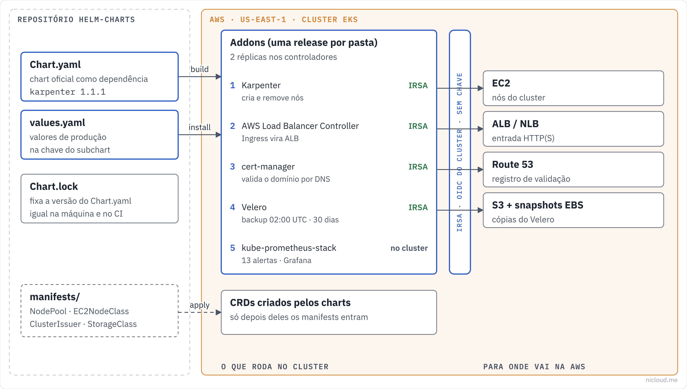

<!-- curso: Nicloud · Kubernetes na AWS -->
# Módulo 4 – Observabilidade, GitOps e backup

## Objetivos de aprendizagem

Neste módulo, você vai aprender a:

- Descrever as peças do **kube-prometheus-stack**: Prometheus, **Prometheus Operator**, Alertmanager e Grafana.
- Ler uma regra de alerta (`expr`, `for`, `severity`) e o roteamento do **Alertmanager**.
- Comparar o Prometheus com o **VictoriaMetrics** em retenção, disco e custo.
- Levar os logs dos pods para o **CloudWatch Logs** com o **Fluent Bit**.
- Monitorar o sistema por fora, como o usuário vê, com o **Uptime Kuma**.
- Gerenciar os addons por **GitOps** com o **ArgoCD**.
- Configurar backup e restauração do cluster com o **Velero** e dizer o que ele **não** cobre.

## Arquitetura

O diagrama mostra a visão geral. Este módulo cobre o que observa o cluster (métricas, logs, checagens externas), o que mantém o cluster igual ao Git (ArgoCD) e o que traz o cluster de volta se ele se perder (Velero).



## kube-prometheus-stack

O chart `prometheus-stack` instala o <u>**kube-prometheus-stack**</u>, um pacote com tudo o que um cluster precisa para métricas:

| Peça | Função |
|---|---|
| **Prometheus** | coleta e guarda as métricas (séries temporais) |
| **Prometheus Operator** | cria e configura o Prometheus a partir de CRDs |
| **Alertmanager** | agrupa os alertas e manda para Slack, PagerDuty, e-mail |
| **Grafana** | painéis |
| **node-exporter** | métricas de cada nó (CPU, memória, disco) |
| **kube-state-metrics** | métricas dos objetos do Kubernetes (pods, deployments, PVCs) |

O <u>**Prometheus Operator**</u> é o que torna o pacote fácil de estender. Em vez de editar um arquivo de configuração do Prometheus, cada time cria recursos do Kubernetes:

- **ServiceMonitor**: "colete as métricas deste Service". O Kong do módulo 2 cria o seu com `serviceMonitor.enabled: true`.
- **PrometheusRule**: regras de alerta.
- **AlertmanagerConfig**: roteamento de alertas de um namespace.

## Exemplo: o Prometheus neste repo

```yaml
# prometheus-stack/values.yaml (trecho)
kube-prometheus-stack:
  defaultRules:
    create: true
  prometheus:
    prometheusSpec:
      retention: 15d
      resources:
        requests: { cpu: 500m, memory: 1Gi }
        limits:   { cpu: "1",  memory: 2Gi }
      storageSpec:
        volumeClaimTemplate:
          spec:
            storageClassName: gp3
            resources:
              requests:
                storage: 50Gi
```

- `retention: 15d`: o Prometheus guarda 15 dias. Mais do que isso pede disco maior ou um armazenamento de longo prazo (VictoriaMetrics, Amazon Managed Prometheus).
- `storageSpec` com **gp3** de 50 GiB: sem volume, as métricas morrem junto com o pod.
- `defaultRules.create: true` liga as dezenas de regras prontas do projeto (etcd, API server, nós, pods).
- O limite de memória de 2 GiB é o primeiro a estourar quando o número de séries cresce. Se o Prometheus reiniciar com **OOMKilled**, o problema é **cardinalidade** (rótulos com muitos valores, como ID de usuário), não falta de memória.

## Alertas e roteamento

Além das regras padrão, o repositório tem 13 regras próprias em `prometheus-stack/manifests/alert-rules.yaml`. Uma regra tem três partes:

```yaml
# prometheus-stack/manifests/alert-rules.yaml (trecho)
- alert: PodCrashLooping
  expr: increase(kube_pod_container_status_restarts_total[15m]) > 5
  for: 0m
```

- `expr`: a consulta em **PromQL**. Aqui, "o contêiner reiniciou mais de 5 vezes nos últimos 15 minutos".
- `for`: por quanto tempo a condição precisa ficar verdadeira para disparar. Com `5m`, um pico de dois minutos não acorda ninguém.
- `labels.severity`: decide para onde o alerta vai.

As 13 regras: `NodeNotReady`, `ClusterDown`, `HighErrorRate`, `HighLatency`, `PodCrashLooping`, `PodPending`, `DeploymentReplicasMismatch`, `PVCAlmostFull`, `DiskUsageHigh`, `HighCPU`, `HighMemory`, `CertificateExpiring30Days` e `CertificateExpiringSoon`.

O <u>**Alertmanager**</u> recebe os alertas e decide o que fazer com eles:

```yaml
# prometheus-stack/manifests/alertmanager-config.yaml (trecho)
route:
  receiver: slack-notifications
  groupBy: ["alertname", "namespace", "pod"]
  groupWait: 30s
  groupInterval: 5m
  repeatInterval: 4h
  routes:
    - receiver: pagerduty-critical
      matchers:
        - { name: severity, value: critical, matchType: "=" }
      repeatInterval: 15m
      continue: true
```

- `groupBy`: alertas com o mesmo nome, namespace e pod viram **uma** notificação. Sem isso, um nó caindo dispara uma mensagem por pod.
- `groupWait: 30s`: espera 30 segundos para juntar os alertas do mesmo grupo antes da primeira mensagem.
- `repeatInterval: 4h`: se continua disparando, lembra a cada 4 horas. Os críticos lembram a cada 15 minutos.
- `continue: true`: o alerta crítico vai para o PagerDuty **e continua** descendo a árvore, chegando também ao Slack.

## Grafana: o que trocar antes de produção

```yaml
# prometheus-stack/values.yaml (trecho)
grafana:
  enabled: true
  adminPassword: "CHANGE_ME"
  service:
    type: LoadBalancer
  persistence:
    enabled: true
    size: 10Gi
    storageClassName: gp3
```

Dois pontos deste arquivo são aceitáveis num laboratório e **não** em produção:

- `adminPassword` em texto no `values.yaml` versionado. Use `grafana.admin.existingSecret`, apontando para um Secret criado fora do Git (ou pelo CSI do módulo 3).
- `service.type: LoadBalancer` expõe o Grafana na Internet. Prefira `ClusterIP` atrás do Ingress com autenticação, ou `kubectl port-forward`.

O mesmo vale para o webhook do Slack (`api_url`): é uma credencial e não deve ficar no Git.

Os painéis podem vir de ConfigMaps. O `grafana-dashboards.yaml` tem o rótulo `grafana_dashboard: "1"`, e o **sidecar** do Grafana importa o painel sozinho.

## VictoriaMetrics

O <u>**VictoriaMetrics**</u> fala a mesma língua do Prometheus (coleta igual, consultas em PromQL, mesmo formato de regras), mas guarda as métricas com bem menos disco e memória. É a opção quando a retenção de 15 dias não basta.

```yaml
# victoria-metrics/values.yaml (trecho)
victoria-metrics-k8s-stack:
  vmsingle:
    enabled: true
    spec:
      retentionPeriod: "90d"
      storage:
        storageClassName: gp3
        resources:
          requests:
            storage: 100Gi
  vmagent:  { enabled: true }
  vmalert:  { enabled: true }
  grafana:  { enabled: false }
```

- `vmsingle`: um único nó com 90 dias de retenção em 100 GiB. O Prometheus deste repositório guarda 15 dias em 50 GiB.
- `vmagent` coleta, e `vmalert` avalia as regras.
- `grafana.enabled: false`: o Grafana do `prometheus-stack` já existe. Basta adicionar o VictoriaMetrics como fonte de dados nele.

Os dois charts aparecem no repositório como alternativas. Em geral, um cluster usa um ou o outro, ou o Prometheus para alertas de curto prazo e o VictoriaMetrics para histórico.

## Logs com Fluent Bit

O <u>**Fluent Bit**</u> roda como **DaemonSet** (um pod por nó), lê os arquivos de log de todos os contêineres do nó e manda para um destino. Aqui, o chart da AWS manda para o **CloudWatch Logs**:

```yaml
# logging/values.yaml (trecho)
aws-for-fluent-bit:
  cloudWatch:
    enabled: true
    region: "us-east-1"
    logGroupName: "/eks/CLUSTER_NAME"
    autoCreateGroup: false
  firehose: { enabled: false }
  kinesis:  { enabled: false }
  serviceAccount:
    annotations:
      eks.amazonaws.com/role-arn: "CHANGE_ME"
  resources:
    requests: { cpu: 100m, memory: 128Mi }
    limits:   { memory: 512Mi }
```

- `autoCreateGroup: false`: o log group precisa existir antes, criado pelo Terraform, com **retenção definida**. Grupo criado automaticamente nasce com retenção infinita, e o custo de armazenamento só cresce.
- A role de IRSA precisa de `logs:PutLogEvents` e `logs:CreateLogStream` naquele grupo.
- Há limite de memória e não há limite de CPU. Se o Fluent Bit for morto por memória, os logs daquele nó param de chegar, e é melhor deixá-lo usar CPU em picos do que perder logs.
- O `livenessProbe` na porta 2020 reinicia o pod se ele travar.

## Uptime Kuma: olhar de fora

Métricas internas dizem que os pods estão saudáveis. Não dizem se o usuário consegue abrir o site. O <u>**Uptime Kuma**</u> faz **monitoramento sintético**: acessa as URLs de tempos em tempos, de fora, e avisa quando não respondem.

```yaml
# uptime-kuma/values.yaml (trecho)
uptime-kuma:
  persistence:
    enabled: true
    size: 5Gi
    storageClass: gp3
  ingress:
    enabled: true
    annotations:
      cert-manager.io/cluster-issuer: letsencrypt-production
    hosts:
      - host: status.example.com
```

Este addon junta três módulos: o Ingress (módulo 2) publica a página, o **ExternalDNS** cria `status.example.com` e o **cert-manager** emite o certificado pelo ClusterIssuer `letsencrypt-production`. O nome do emissor estava errado (`letsencrypt-prod`) até novembro de 2026.

O ponto fraco de um monitor dentro do cluster é óbvio: se o cluster cair, o monitor cai junto. Para o alerta de "fora do ar" mais importante, use também um serviço externo.

## ArgoCD e GitOps

<u>**GitOps**</u> é operar o cluster a partir do Git: o estado desejado fica no repositório, e um agente dentro do cluster compara o que está rodando com o Git e corrige a diferença. Ninguém roda `helm upgrade` na mão.

O <u>**ArgoCD**</u> é esse agente:

```yaml
# argocd/values.yaml (trecho)
argo-cd:
  server:
    replicas: 2
    service:
      type: ClusterIP
  controller:
    replicas: 1
  repoServer:
    replicas: 2
```

- `server` (API e interface) e `repoServer` (que baixa o Git e gera os manifests, inclusive rodando o Helm) têm duas réplicas cada.
- O `controller` fica com **uma**. Mais réplicas do controller **dividem os clusters** entre si (sharding), não fazem cópias de reserva para o mesmo cluster. Com um cluster só, uma réplica basta. Se ela cair, o Kubernetes recria o pod, e nada que já está rodando para.

Cada pasta deste repositório vira uma <u>**Application**</u>:

```yaml
apiVersion: argoproj.io/v1alpha1
kind: Application
metadata:
  name: ingress-nginx
  namespace: argocd
spec:
  source:
    repoURL: <URL do repositório>
    targetRevision: main
    path: ingress-nginx
  destination:
    server: https://kubernetes.default.svc
    namespace: ingress-nginx
  syncPolicy:
    automated:
      prune: true
      selfHeal: true
    syncOptions:
      - CreateNamespace=true
```

- `automated.selfHeal`: se alguém mudar algo à mão no cluster, o ArgoCD desfaz.
- `automated.prune`: o que sai do Git sai do cluster.
- As pastas com `manifests/` pedem uma Application com **duas fontes** (o chart e a pasta de manifests) ou uma segunda Application, aplicada depois, como na ordem do módulo 1.

Com várias Applications, o padrão **app of apps** ajuda: uma Application raiz aponta para uma pasta com as outras, e o cluster inteiro sobe a partir de um único recurso.

## Velero: backup e restauração

O <u>**Velero**</u> faz backup dos **recursos do Kubernetes** (os YAML de tudo o que está no cluster) para o S3 e dos **volumes** como snapshots de EBS.

```yaml
# velero/values.yaml (trecho)
velero:
  initContainers:
    - name: velero-plugin-for-aws
      image: velero/velero-plugin-for-aws:v1.10.0
  configuration:
    backupStorageLocation:
      - name: default
        provider: aws
        bucket: "CHANGE_ME"
    volumeSnapshotLocation:
      - name: default
        provider: aws
  schedules:
    daily-backup:
      schedule: "0 2 * * *"
      template:
        ttl: "720h"
```

- O **plugin da AWS** entra como init container e ensina o Velero a falar com S3 e EBS. A versão do plugin precisa ser compatível com a do Velero.
- `backupStorageLocation`: o bucket onde vão os YAML. Use um bucket com versionamento e, de preferência, em outra conta, para um invasor no cluster não conseguir apagar os backups.
- `volumeSnapshotLocation`: onde ficam os snapshots de EBS.
- `schedule: "0 2 * * *"` com `ttl: 720h`: backup diário às 02:00 UTC, guardado por 30 dias.

### Como funciona

#### (1) Backup

No horário, o Velero lista os recursos pela API, grava em `.tar.gz` no S3 e pede à AWS um snapshot de cada volume EBS.

#### (2) Restauração

`velero restore create --from-backup <nome>` recria os recursos e cria volumes novos a partir dos snapshots. Dá para restaurar um namespace só (`--include-namespaces`) ou só alguns tipos (`--include-resources`).

### O que o Velero não cobre

O guia `disaster-recovery.md` lista o que fica fora do Velero, por ser serviço da AWS e não recurso do cluster:

| Componente | Como proteger |
|---|---|
| RDS | snapshots automáticos e manuais |
| Dados no S3 | versionamento e replicação entre regiões |
| Route 53, IAM, VPC | Terraform (o código é o backup) |
| Control plane do EKS | gerenciado pela AWS, recriado pelo Terraform |

Com backup diário, o **RPO** (quanto dado você aceita perder) dos cenários que dependem do Velero é de até **24 horas**. Se isso não basta, aumente a frequência. O guia também traz o **RTO** (quanto tempo fica fora) de cada cenário: de menos de um minuto para um pod a até 4 horas para uma região inteira.

Backup que nunca foi restaurado é uma hipótese. Restaure um namespace num cluster de teste pelo menos uma vez por trimestre.

## Resumo

O **kube-prometheus-stack** traz Prometheus, Alertmanager, Grafana e os exportadores, e o **Prometheus Operator** deixa cada time adicionar coletas e alertas com CRDs. Aqui o Prometheus guarda 15 dias em 50 GiB de gp3, e as 13 regras próprias passam pelo **Alertmanager**, que agrupa, manda os críticos para o PagerDuty e para o Slack e lembra a cada 15 minutos ou 4 horas. Senha do Grafana, webhook do Slack e Grafana público são coisas de laboratório que precisam sair antes de produção.

Quando 15 dias não bastam, o **VictoriaMetrics** guarda 90 dias com menos recurso e as mesmas consultas. Os logs saem de cada nó pelo **Fluent Bit** para um log group do CloudWatch com retenção definida, e o **Uptime Kuma** confere de fora se o usuário consegue chegar, usando o Ingress, o ExternalDNS e o cert-manager do módulo 2.

O **ArgoCD** mantém o cluster igual ao Git, com uma Application por pasta, autocorreção e remoção do que saiu do repositório. O **Velero** faz backup diário dos recursos e dos volumes, guardado por 30 dias. Ele não cobre RDS, S3 nem a infraestrutura da AWS, e só é confiável depois de você restaurar pelo menos uma vez.

## Quiz

Um time quer que o Prometheus colete as métricas do seu serviço. O que ele cria, sem mexer na configuração do Prometheus?

- Um **ServiceMonitor** apontando para o Service. O Prometheus Operator lê o recurso e configura a coleta.

A regra `HighCPU` tem `for: 5m`. A CPU de um nó ficou em 95% por 3 minutos e voltou ao normal. O alerta disparou?

- Não. A condição precisava ficar verdadeira por 5 minutos seguidos.

Um nó caiu com 40 pods. Por que o Slack recebeu poucas mensagens, e não 40?

- O `groupBy` e o `groupWait` do Alertmanager juntam alertas parecidos numa notificação.

Um alerta `critical` chegou no PagerDuty e também no Slack. Qual configuração fez isso?

- `continue: true` na rota do PagerDuty. Sem ele, o alerta parava na primeira rota que combinou.

O Prometheus reinicia com OOMKilled toda tarde, depois de um deploy novo de uma aplicação. Qual a primeira suspeita?

- Cardinalidade: a aplicação nova expõe métricas com rótulos de muitos valores (ID de usuário, URL completa). Aumentar a memória só adia o problema.

Você precisa de 90 dias de métricas para planejar capacidade. O que usar neste repositório?

- O VictoriaMetrics (`retentionPeriod: 90d`), como fonte de dados no mesmo Grafana.

A conta de CloudWatch Logs cresce todo mês, mesmo com o volume de logs estável. O que conferir no Fluent Bit?

- Se o log group foi criado com retenção. Com `autoCreateGroup: true`, o grupo nasceria com retenção infinita. Aqui ele deve ser criado pelo Terraform com retenção definida.

Alguém editou à mão o número de réplicas de um deployment gerenciado pelo ArgoCD. O que acontece?

- Com `selfHeal: true`, o ArgoCD volta o valor para o que está no Git.

O ArgoCD gerencia um cluster só. Vale subir o `controller` para 3 réplicas?

- Não. Réplicas do controller dividem clusters entre si (sharding). Com um cluster, uma réplica faz todo o trabalho.

O cluster foi perdido às 18:00, e o último backup do Velero é das 02:00. Quanto de dado do cluster pode ter sido perdido, e o que não volta pelo Velero?

- Até 16 horas de mudanças nos recursos e volumes. RDS, dados no S3 e recursos da AWS como IAM e Route 53 voltam por outros caminhos (snapshots, versionamento, Terraform).

## Recursos adicionais

- [kube-prometheus-stack](https://github.com/prometheus-community/helm-charts/tree/main/charts/kube-prometheus-stack)
- [Prometheus Operator: guia de uso](https://prometheus-operator.dev/docs/developer/getting-started/)
- [Alertmanager: configuração](https://prometheus.io/docs/alerting/latest/configuration/)
- [VictoriaMetrics: operador e stack para Kubernetes](https://docs.victoriametrics.com/helm/victoria-metrics-k8s-stack/)
- [Fluent Bit no EKS (AWS)](https://docs.aws.amazon.com/AmazonCloudWatch/latest/monitoring/Container-Insights-setup-logs-FluentBit.html)
- [Uptime Kuma](https://github.com/louislam/uptime-kuma)
- [ArgoCD: conceitos e Applications](https://argo-cd.readthedocs.io/en/stable/core_concepts/)
- [Velero: backup e restauração](https://velero.io/docs/main/)
- [Velero plugin for AWS](https://github.com/vmware-tanzu/velero-plugin-for-aws)
