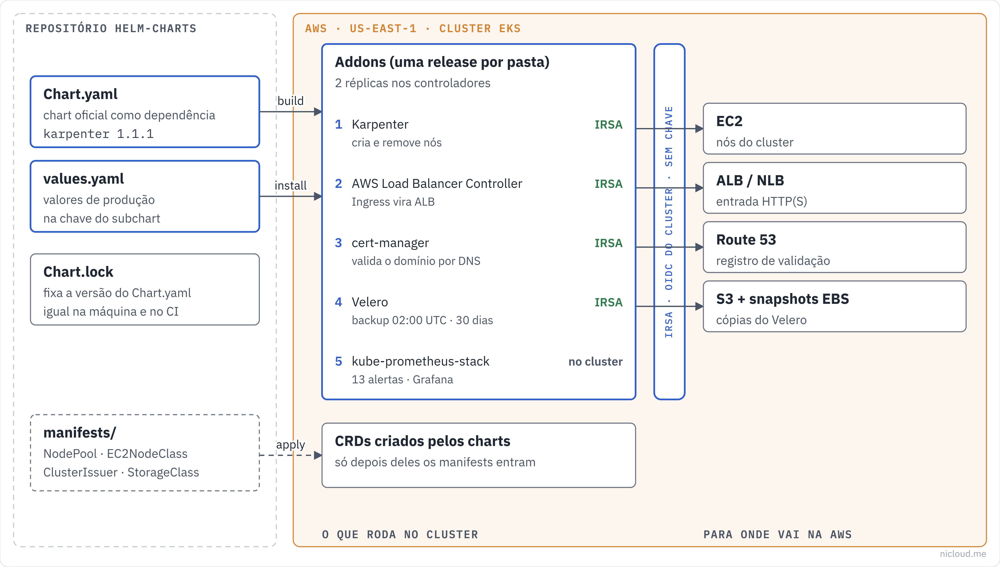

<!-- curso: Nicloud · Kubernetes na AWS -->
# Módulo 1 – Helm e os addons do EKS

## Objetivos de aprendizagem

Neste módulo, você vai aprender a:

- Descrever o que é um **chart** do Helm e o que ele empacota.
- Explicar o padrão **wrapper chart** e por que ele facilita atualizar addons.
- Usar `helm dependency build` e entender o papel do **Chart.lock**.
- Sobrescrever valores de um **subchart** no `values.yaml`.
- Dar permissão AWS a um pod com **IRSA**, sem chave guardada.
- Configurar alta disponibilidade e agendamento de backup nos addons.
- Explicar por que alguns manifests só podem ser aplicados depois do chart.

## Arquitetura

Visão geral do que este repositório faz, no padrão de diagrama da Nicloud: à esquerda quem chama, no meio as regras, à direita para onde vai.



## Helm e charts

O <u>**Helm**</u> é o gerenciador de pacotes do Kubernetes. Um **chart** é o pacote: um `Chart.yaml` (nome, versão, dependências), um `values.yaml` (os valores que você pode mudar) e os templates que viram manifests no cluster.

Instalar um chart cria uma **release**. A release tem histórico, então dá para atualizar (`helm upgrade`) e voltar (`helm rollback`) com um comando.

### Quando usar

Use Helm para software de terceiros que você vai atualizar várias vezes (Karpenter, cert-manager, Prometheus). Para o manifest de um único recurso seu, `kubectl apply` ou Kustomize resolvem.

## Wrapper chart

Este repositório não copia os charts oficiais. Cada pasta é um <u>**wrapper chart**</u>: um chart pequeno que declara o chart oficial como **dependência** e só guarda os valores de produção.

A vantagem é que atualizar um addon vira trocar um número de versão. Os templates continuam sendo os do mantenedor.

## Exemplo: o wrapper do Karpenter

```yaml
# karpenter/Chart.yaml
apiVersion: v2
name: karpenter
version: 0.1.0
appVersion: "1.1.1"
dependencies:
  - name: karpenter
    version: 1.1.1
    repository: "oci://public.ecr.aws/karpenter"
```

### Como funciona

#### (1) Baixar a dependência

`helm dependency build` lê o `Chart.yaml`, baixa o chart oficial para `charts/` e respeita as versões gravadas no **Chart.lock**. O lock garante que a sua máquina e o CI instalam exatamente a mesma versão.

#### (2) Instalar com os valores de produção

`helm install karpenter . -n kube-system -f values.yaml` instala o wrapper, que por sua vez instala o chart oficial com os valores daqui.

## Valores do subchart

Os valores do chart oficial ficam **dentro de uma chave com o nome da dependência**. Sem essa chave, o valor vai para o wrapper e o chart oficial nunca vê.

## Exemplo: alta disponibilidade e IRSA

```yaml
# cert-manager/values.yaml
cert-manager:
  crds:
    enabled: true
  replicaCount: 2
  serviceAccount:
    annotations:
      eks.amazonaws.com/role-arn: "arn:aws:iam::ACCOUNT_ID:role/CERT_MANAGER_ROLE_NAME"
```

- `replicaCount: 2` mantém o addon de pé se um nó cair.
- `crds.enabled: true` instala os **CRDs** (os tipos novos, como `Certificate` e `ClusterIssuer`) junto com o chart.

## IRSA: permissão AWS sem chave

O <u>**IRSA**</u> (IAM Roles for Service Accounts) liga a **service account** do pod a uma **role do IAM**. O pod recebe credenciais temporárias pelo OIDC do cluster, sem access key em Secret.

A anotação `eks.amazonaws.com/role-arn` é toda a ligação do lado do Kubernetes. Do lado da AWS, a role precisa confiar no provedor OIDC do cluster e naquela service account específica.

### Quem usa IRSA neste repo

| Addon | Para que precisa da AWS |
|---|---|
| Karpenter | criar e remover instâncias EC2 |
| AWS Load Balancer Controller | criar ALB e NLB |
| cert-manager | criar registros no Route 53 para validar o certificado |
| Velero | gravar backup no S3 e criar snapshot de EBS |

## Exemplo: backup agendado com Velero

```yaml
# velero/values.yaml
velero:
  schedules:
    daily-backup:
      schedule: "0 2 * * *"
      template:
        ttl: "720h"
```

O backup roda todo dia às 02:00 UTC e cada cópia vive **720 horas (30 dias)**. O passo a passo de restauração está em `disaster-recovery.md`.

## Manifests depois do chart

Algumas pastas têm `manifests/` para aplicar **depois** do chart, como o `NodePool` e o `EC2NodeClass` do Karpenter e o `ClusterIssuer` do cert-manager. A ordem importa: esses recursos usam tipos que só existem depois que o chart instala os **CRDs**. Aplicar antes dá erro de tipo desconhecido.

## Resumo

O **Helm** empacota software para Kubernetes em **charts**, e cada instalação vira uma **release** com histórico, que dá para atualizar e voltar.

Este repositório usa **wrapper charts**: cada addon declara o chart oficial como dependência e guarda só os valores de produção. Atualizar vira trocar a versão no `Chart.yaml`, e o **Chart.lock** garante a mesma versão em todo lugar. Os valores do chart oficial ficam dentro da chave com o nome da dependência.

Os addons que falam com a AWS usam **IRSA**: a service account aponta para uma role do IAM e o pod recebe credencial temporária, sem chave guardada. Os valores de produção trazem **duas réplicas** para alta disponibilidade e o **Velero** faz backup diário com retenção de 30 dias.

Por fim, recursos que dependem de **CRDs** (NodePool, ClusterIssuer) só entram depois do chart.

## Quiz

Você precisa atualizar o cert-manager para a versão nova. O que muda no repositório?

- A versão da dependência no `Chart.yaml` e o `Chart.lock` (com `helm dependency update`). Os templates são os do mantenedor.

Você colocou `replicaCount: 2` na raiz do `values.yaml` do wrapper e o cert-manager continua com uma réplica. Por quê?

- O valor precisa ficar dentro da chave `cert-manager:`, que é o nome da dependência.

O Velero precisa gravar no S3. Qual o jeito recomendado de dar essa permissão no EKS?

- IRSA: anotar a service account com a role do IAM. Nada de access key em Secret.

`kubectl apply -f karpenter/manifests/default-nodepool.yaml` falhou com "no matches for kind NodePool". O que faltou?

- Instalar o chart do Karpenter antes. Ele cria o CRD `NodePool`.

Para que serve o `Chart.lock`?

- Fixar as versões exatas das dependências, para o CI e a sua máquina instalarem a mesma coisa.

O backup do Velero roda às 02:00 UTC com `ttl: 720h`. Por quantos dias cada backup fica guardado?

- 30 dias.

## Recursos adicionais

- [Charts (documentação do Helm)](https://helm.sh/docs/topics/charts/)
- [helm dependency](https://helm.sh/docs/helm/helm_dependency/)
- [Boas práticas de values](https://helm.sh/docs/chart_best_practices/values/)
- [IAM roles for service accounts (EKS)](https://docs.aws.amazon.com/eks/latest/userguide/iam-roles-for-service-accounts.html)
- [Karpenter](https://karpenter.sh/docs/)
- [AWS Load Balancer Controller](https://kubernetes-sigs.github.io/aws-load-balancer-controller/latest/)
- [Velero](https://velero.io/docs/)
